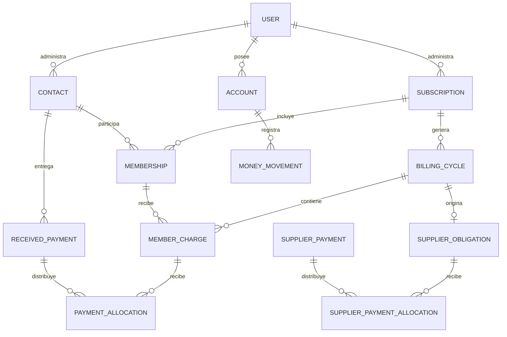

# EVA — Modelo conceptual de datos

Este documento define el núcleo propuesto y las extensiones previstas. No todas las entidades se implementan en la primera entrega; campos, índices y restricciones finales dependen del diseño físico. El diccionario 13 concreta responsabilidades y unifica nombres antes de implementar; no crear tablas duplicadas por nombres históricos.

## 1. Núcleo de identidad y finanzas

| Entidad | Responsabilidad y datos esenciales |
| --- | --- |
| User | Identidad, zona horaria, moneda preferida; autenticación elegida aparte |
| Contact | Persona administrada, propietario, nombre y datos opcionales |
| Account | Cuenta de dinero o de crédito, propietario, tipo, moneda, saldo/deuda inicial y estado; tarjeta con extensión propia, sin duplicar saldo |
| Category | Clasificación por propietario |
| MoneyMovement | Entrada/salida confirmada, cuenta, moneda, importe, fecha, motivo, fuente y estado de reversión |
| Transfer | Une los dos efectos de una transferencia entre cuentas propias |
| MovementItem | Desglose opcional por concepto/categoría; suma igual al total |
| AuditEvent | Autor, acción, entidad, momento y motivo; evitar copiar secretos o correos completos |

Contacto y usuario no son lo mismo. Si después se permite acceso de participantes, agregar vínculo verificado e invitaciones con permisos; no vincular automáticamente por nombre, teléfono o correo coincidente.

## 2. Suscripciones y cobros

| Entidad | Responsabilidad y datos esenciales |
| --- | --- |
| Subscription | Servicio, propietario, fecha de inicio, próxima renovación/pago programado, estado y cuenta preferida para pagar |
| SubscriptionTerms | Costo, intervalo/frecuencia y reglas versionadas, moneda y vigencia; próximo pago confirmado permite verificar calendario |
| Membership | Contacto en servicio, inicio/fin, estado; admite reingresos sin perder historia |
| MembershipTerms | Cuota, regla de incorporación y vigencia por participante |
| Courtesy | Beneficio con fechas, alcance, motivo y autor; permanente o temporal |
| BillingCycle | Período explícito, vencimientos, costo y reglas históricas |
| MemberCharge | Cargo de una participación por ciclo: base, prorrateo, exención y neto |
| ChargeAdjustment | Aumento, descuento o condonación documentados sin sobrescribir el cargo original |
| ReceivedPayment | Cobro del contacto, importe, moneda, fecha y movimiento real asociado cuando corresponda |
| PaymentAllocation | Parte de un cobro aplicada a un cargo; relación muchos a muchos |
| SupplierObligation | Importe a pagar al proveedor para un ciclo |
| SupplierPayment | Pago al proveedor y vínculo con la salida real de dinero |
| SupplierPaymentAllocation | Extensión futura para distribuir pagos al proveedor entre ciclos; no requerida en el alcance inicial |

Saldo a favor se obtiene de dinero recibido menos aplicaciones, devoluciones y reversiones. No necesita una tabla independiente de «saldo» en el primer núcleo. Si se guarda una caché, debe poder reconstruirse.

Un anticipo aún no aplicado guarda destino por defecto al servicio y preferencia de cobertura; esto no equivale a un cargo cancelado. Confirmado: no congela precio. Debe poder trasladarse a otro destino mediante historial de redistribución, sin duplicar dinero disponible.

Actualizaciones confirmadas: plazas identificables y cuotas independientes por plaza, con total agregado por contacto. Los cargos requieren desglose suficiente para el estado de cuenta. Un ReceivedPayment admite aplicaciones entre servicios/préstamos vinculadas al mismo movimiento real. Loan y DebtConversion conservan cargos de origen y trasladan únicamente pendiente sin duplicarlo.

Aclaración más reciente: cuotas individuales por plaza (10 + 8 o 10 + 10), detalle separado y suma por contacto; no asumir reparto automático de cuota global. Calendario por inicio + intervalo configurable + próxima fecha indicada por proveedor; guardar cambios con vigencia y no deducir renovación de la fecha real de pago tardío.

Añadir Refund para devoluciones parciales de cobros con referencia a pagos/aplicaciones de origen, importe solicitado, estado y salida real asociada. Solicitar/programar devolución no significa que el dinero ya salió. Los cambios a plan individual y bajas pueden programarse con fecha efectiva; deben cancelar cobertura/cargos futuros pertinentes y conservar período actual, deudas trasladadas e historial. Las diferencias por cambio de cuota requieren ajustes vinculados a sus períodos sin doble cobro.

## 3. Relaciones principales

El diagrama es un resumen; omite entidades de vigencias, captura, auditoría y reversiones.

## 4. Captura asistida y extensiones

| Entidad prevista | Responsabilidad |
| --- | --- |
| InboxAddress | Dirección asociada al usuario, estado, rotación/revocación; unicidad real en BD |
| SourceDocument | Correo o fotografía, propietario, referencia segura al archivo, hash y metadatos mínimos |
| ProcessingAttempt | Extracción, versión del modelo/parser, fecha, error y resultado validado |
| MovementProposal | Datos propuestos, estado, revisión y vínculo con movimiento/cobro aprobado |
| Attachment | Archivos asociados a propuestas y movimientos, acceso privado y retención |
| AnalysisRun | Análisis opcional persistido con período, filtros, versión y respuesta |
| ExportJob | Solo si las exportaciones necesitan cola, archivos persistidos o procesamiento asíncrono |

Un documento puede producir varias propuestas. Una propuesta aceptada referencia el registro final y puede aportar evidencia a un registro existente. La retención del documento original se configura sin romper la trazabilidad mínima del movimiento.

Captura confirmada: revisión individual o por lote con confirmación; candidatos a duplicado agrupables o visibles por separado; reglas de remitente/contacto como sugerencias revisables. Añadir preferencias de revisión/notificación/retención, CandidateMatch para coincidencias sin fusionar registros todavía y ConfirmationBatch para trazabilidad de confirmación del conjunto si aporta al diseño físico. AnalysisRun/consulta de chat conserva filtros elegidos; no analizar cuentas fuera del alcance seleccionado. Las relaciones y estados finales se definirán antes de migraciones.

No fijar marca bancaria en columnas: canal/proveedor y datos normalizados permiten incorporar nuevas fuentes. No usar JSON como reemplazo de cargos, pagos y relaciones; reservarlo para metadatos/extracción.

## 5. Invariantes del esquema y del backend

1. Toda operación une entidades del mismo propietario; una FK por ID sola no garantiza ese aislamiento. Evaluar claves compuestas y autorización en API.
2. Montos exactos en decimal o unidades menores enteras; nunca coma flotante. Moneda explícita; sin aplicaciones entre monedas distintas.
3. Una aplicación es positiva, no supera lo disponible del pago ni lo pendiente del cargo. Validar dentro de una transacción con control de concurrencia.
4. Cargo ordinario único por plaza/ciclo; ciclos de un servicio sin superposición. Reintentar generación no duplica cargos. Dos plazas del mismo contacto tienen cargos separados.
5. Un pago real tiene un vínculo único con su movimiento; registrar su reparto no crea nuevos movimientos.
6. Aceptación de propuesta atómica: movimiento, cobro/aplicaciones si corresponden, estado final y auditoría se confirman juntos.
7. IDs estables; nombres, fechas «pagado hasta» y banderas «pagado» no sustituyen relaciones ni asignaciones.
8. Historial financiero no desaparece al archivar contactos o servicios. Definir por separado eliminación de cuenta y tratamiento de sus datos.
9. Guardar instantáneas del precio y regla al emitir; referencias a configuración actual no bastan para reproducir el pasado.
10. Saldo de cuenta, deuda y cobertura se derivan de registros activos; si se almacenan agregados, reconciliarlos.
11. Reembolsos y reversiones referencian el original y no permiten devolver más que lo disponible. Evitar alterar pagos históricos silenciosamente.
12. Los cargos cancelados/no vigentes y movimientos revertidos tienen tratamiento explícito en informes.

## 6. Elección técnica propuesta

Acceso/offline/respaldos confirmados: identidad admite Google y correo; bloqueo local PIN/biometría configurable. Decisión vigente: caché offline de solo lectura; escrituras/confirmaciones solo con internet. Retirar cola SyncOperation/SyncConflict del alcance offline inicial; conservar idempotencia y control de concurrencia en API porque reintentos/dispositivos siguen existiendo online. BackupManifest/BackupJob y preferencias de notificación/bloqueo son candidatos de infraestructura. Respaldos manuales/automáticos con frecuencia/contenido/retención configurables y restauración por reemplazo o incorporación con revisión. No almacenar PIN/contraseñas en texto plano ni datos ajenos en caché.

Ampliaciones de planificación confirmadas: Budget (categoría/subcategoría, período configurable, importe y reglas de aviso), SavingsGoal (objetivo, fecha opcional), GoalContribution (cuenta y movimiento/apartado asociado sin sumar dinero ficticio), RecurringTemplate (frecuencia y configuración), RecurringOccurrence (instancia única y propuesta pendiente), BalanceAdjustment (cuenta, fecha, motivo y diferencia) y DashboardPreference (tarjetas habilitadas/orden). Entidades físicas sujetas a cierre de reglas; no repetir presupuesto padre e hijo en sumas ni contribución y saldo de cuenta como dinero adicional. Las recurrencias siempre requieren confirmación y pueden vincularse a propuestas de correo/foto; la vinculación no crea segundo movimiento.

PostgreSQL desde desarrollo hasta producción, API compartida para móvil/web y almacenamiento privado de archivos. Prisma es candidato porque ya existe una propuesta, pero se debe elegir y fijar versión antes de escribir migraciones.

La documentación anterior promete pasar de SQLite a PostgreSQL cambiando únicamente `provider`. No usar esa promesa como plan: las migraciones dependen del motor y ciertos tipos nativos también. Referencia: [limitaciones de Prisma Migrate v7](https://docs.prisma.io/docs/orm/v7/prisma-migrate/understanding-prisma-migrate/limitations-and-known-issues). El esquema actual declara SQLite y tipos `@db.Decimal`; se debe validar compatibilidad con el motor y versión elegidos.

Gemini puede interpretar imágenes y devolver estructuras, pero los valores deben validarse antes de confirmarlos. Referencias: [comprensión de imágenes](https://ai.google.dev/gemini-api/docs/image-understanding), [salidas estructuradas](https://ai.google.dev/gemini-api/docs/structured-output). Modelo, costos y proveedor de recepción de correo se evalúan al implementar; no fijar versiones antiguas ni prometer servicios gratuitos sin verificar.
