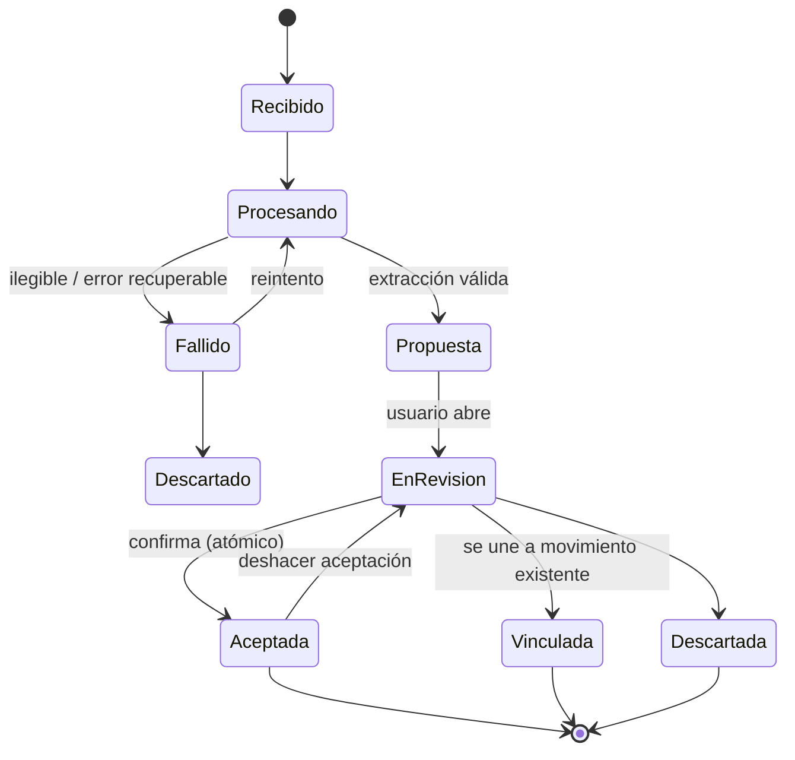

# 07 — Captura asistida e IA (Entrega 4)

La captura **propone**; el usuario **confirma**. Ningún dato extraído modifica dinero, deuda o cuotas sin confirmación explícita. **[C]**

## 1. Fuentes

Correo reenviado, fotografía, PDF multipágina y registro manual. Se captura: gastos, ingresos, comprobantes, cronogramas y estados de cuenta según su tipo. Un documento puede producir **varias propuestas**; varios archivos de la **misma operación** no crean varios movimientos. **[C]**

## 2. Flujo y estados



| Regla | Detalle |
| --- | --- |
| RN-CA01 | Cada propuesta lleva propietario, procedencia, momento, estado, errores recuperables y vínculo al registro final. **[C]** |
| RN-CA02 | **Aceptar** es atómico: movimiento, cobro/aplicaciones si corresponden, estado final y auditoría se confirman **juntos**. Aceptar dos veces **no** duplica. **[C]** |
| RN-CA03 | **Descartar** no afecta saldos. **[C]** |
| RN-CA04 | **Deshacer la aceptación** revierte los efectos y devuelve a revisión (RN-V03). **[C]** |
| RN-CA05 | Si un dato cambia **después de la vista previa**, se pide revisar ese cambio; no se acepta en silencio una versión distinta (se usa `previewToken`, [13](13-contrato-api.md)). **[C]** |
| RN-CA06 | Datos mínimos para aceptar: propietario, cuenta, importe positivo, moneda, dirección, fecha. Categoría puede faltar. Propuestas incompletas se **editan o excluyen** del lote. **[C]** |
| RN-CA07 | **Lote**: se muestran propuestas, importes, cuentas y aplicaciones antes de confirmar. Cada propuesta se confirma en **su propia transacción**; un fallo no rompe las demás y se informa *aceptadas / fallidas* con detalle. **[P D-15]** |
| RN-CA08 | Revisión **individual o por lote**, preferencia configurable. **[C]** |

## 3. Entrada a la bandeja

- Aviso al abrir, contador en el panel y notificaciones opcionales (configurables). **[C]**
- Dos colas distintas: *propuestas por aceptar* (no afectan saldo) y *movimientos aceptados por clasificar* (sí afectan). **[C]**
- Dirección de recepción inmutable por usuario: `gastos.{nombre}-{hash3}@<dominio>`. **No cambia** aunque cambie el nombre; puede **rotarse o revocarse** si se compromete. **[C]** (formato del doc 08 histórico; ver [10 T-14](10-decisiones.md) para el dominio y proveedor, aún sin contratar).

## 4. Duplicados

| Regla | Detalle |
| --- | --- |
| RN-DU01 | **Reentrega exacta** del mismo mensaje/documento (mismo ID de mensaje o mismo *hash* del contenido normalizado): se **deduplica de forma idempotente** en la recepción; un reintento nunca parece un movimiento nuevo. **[C/P]** |
| RN-DU02 | **Posible coincidencia entre operaciones** (correo + foto + registro manual del mismo pago): se detecta por *identificador de operación* si existe; si no, por mismo importe + misma cuenta/canal + diferencia de fecha-hora ≤ **24 h** (umbral configurable). **Importe y día iguales no bastan** para descartar un pago legítimo. **[P D-23]** |
| RN-DU03 | Presentación configurable: **propuestas separadas con advertencia** o **agrupadas como posible coincidencia** preguntando si son la misma operación. **[C]** |
| RN-DU04 | Si se confirma la misma operación, la **evidencia** (correo/foto) se vincula al registro único; si ya hay un movimiento manual, se vincula la evidencia a él **sin crear otro**. **[C]** |

## 5. Contactos, cobros y clasificación

- Se **sugieren** contacto y conceptos con datos y reglas por remitente; el administrador revisa y confirma y puede elegir manualmente. Un nombre coincidente **no** asigna un pago de forma irrevocable. **[C]**
- Sugerir categoría "servicios" **no cancela** un cargo; aplicar a deuda es otra decisión. **[C]**
- Clasificación: reglas del usuario antes que Gemini ([05 RN-CL04](05-finanzas-personales.md)). **[C]**

## 6. Contrato con Gemini

La IA devuelve **JSON estructurado**; el servidor lo **valida** con el mismo esquema de dominio antes de proponer. Resultado inválido → estado `Fallido` con el motivo, y el usuario puede registrar a mano.

```jsonc
// Esquema de salida esperado de la extracción (validado con Zod)
{
  "documentType": "payment_receipt | bank_statement | loan_schedule | loan_summary | card_statement | other",
  "isTransaction": true,              // false => publicidad/boletín: se descarta sin crear propuesta
  "confidence": 0.0,                  // 0..1, informativo (nunca decide aceptar)
  "movements": [{
    "direction": "income | expense | transfer",
    "amount": "10.25",                // decimal exacto como texto
    "currency": "PEN",
    "occurredOn": "2026-10-12",       // fecha local; null si no consta
    "counterparty": "Chifa Central",
    "channel": "Yape",
    "operationId": "1234567",         // si existe en el documento
    "concept": null,                  // null si no hay concepto (no inferir)
    "suggestedCategory": null,
    "items": [{ "concept": "", "amount": "" }]
  }],
  "missingFields": ["occurredOn"],    // lo que debe preguntar la app
  "warnings": []
}
```

**Reglas de la integración:**

1. La clave de Gemini vive **solo en el servidor** (jamás en `EXPO_PUBLIC_*`). **[C]**
2. El contenido del correo/comprobante es **dato no confiable**: se envía como contenido a analizar, nunca como instrucciones; el prompt del sistema prohíbe ejecutar órdenes del documento; la salida solo puede ser el esquema anterior. Ninguna herramienta de la IA modifica dinero. **[C]**
3. No se infiere el uso de un Yape sin concepto (`concept: null` → se pregunta o se aplica una regla del usuario). **[C]**
4. Se envía **solo el contexto necesario**, no todos los documentos originales. **[P]**
5. **Cálculos fuera de la IA**: importes, saldos y deudas los calcula el código determinista. **[C]**
6. **Fallo o límite de IA** → registro manual disponible; la captura falla con estado recuperable. **[C]**
7. **Control de uso**: cada tarea registra modelo, tokens, reintentos y costo estimado (`usage_record`). Se define un **techo mensual configurable** y, al agotarlo, se detienen las nuevas tareas de IA. Mientras no se mida el consumo real, el valor inicial es **30 tareas/día**. **[P D-27]**
8. **Modelo y SDK**: se eligen al implementar la E4 con la documentación vigente de Google; no se fija hoy ninguna versión ni tarifa. **[C]**

## 7. Datos bancarios y documentos

Ver [06 §3](06-prestamos-y-tarjetas.md): confirmación por documento/usuario, tipos de documento, calendario de ayuda, preguntas de lo ausente.

## 8. Conservación de originales

| Regla | Detalle |
| --- | --- |
| RN-AR01 | Guardar originales es **configurable**: elegir cuáles guardar y el **plazo de eliminación**. **[C]** |
| RN-AR02 | Plazo predeterminado propuesto: **90 días** desde la aceptación; configurable y con eliminación manual. **[P D-24]** |
| RN-AR03 | La retención aplica **al archivo**; no borra pagos ni movimientos. Se conservan los **metadatos mínimos de procedencia y decisión** tras eliminar el original. **[C]** |
| RN-AR04 | Archivos **privados por propietario** (almacenamiento privado, acceso por URL firmada de corta vida); accesibles también desde la web futura. **[C]** |
| RN-AR05 | Un documento ligado a **varios movimientos pendientes** no se elimina hasta resolver todos. **[P]** |
| RN-AR06 | Un archivo eliminado por retención puede seguir en copias antiguas: la política de **purga de respaldos** se define en la E5 ([09 §6](09-seguridad-acceso-respaldos.md)). |

## 9. Análisis con Gemini (chat y reportes)

- El usuario **selecciona** cuentas, servicios, categorías y períodos incluidos; no se analiza fuera del alcance elegido. **[C]**
- El resultado informa **período, filtros, datos faltantes y fecha de análisis**; no se presenta como dato bancario confirmado ni como tasa real. **[C/P]**
- Persistencia opcional (`analysis_request`/`analysis_result`) con filtros, modelo y fecha. El historial del chat es **opt-in** y se puede borrar. **[P]**
- Gemini **no** confirma movimientos, modifica deudas ni realiza pagos. **[C]**
