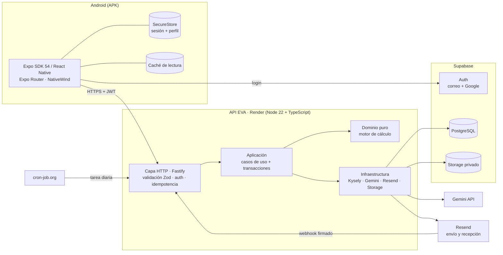

# 11 — Arquitectura

> **Estado (17-nov-2026):** este documento describe la arquitectura **desplegada**. Las decisiones que la originaron están en [10](10-decisiones.md) (T-01…T-16 y D-73…D-80). Cómo se opera y publica: [`../operacion/`](../operacion/01-guia-de-desarrollo.md). Vista gráfica: [`../mapa-eva.html`](../mapa-eva.html).

## 1. Vista general



**Principios** (decisiones en [10](10-decisiones.md)):

- El móvil **autentica con Supabase** pero **todas las escrituras financieras pasan por la API**, que valida la identidad y el propietario.
- Una sola API para móvil y futura web. No hay una segunda base financiera.
- El **dominio es puro** (sin base de datos, reloj ni red): se prueba exhaustivamente sin infraestructura.
- Los trabajos periódicos (respaldo, limpieza) son idempotentes y **nunca ejecutan cobros bancarios**.
- La app **nunca calcula dinero**: muestra lo que devuelve la API.

## 2. Backend

```
EVA-Backend/
├─ migrations/                 # NNNN_descripcion.sql: fuente de verdad del esquema; inmutables (25 aplicadas)
├─ src/
│  ├─ domain/                  # PURO: money, localDate, calendar, proration, allocation, exit, costs…
│  ├─ application/             # casos de uso (una transacción por operación que toca dinero)
│  ├─ infra/                   # db (Kysely), auth (JWKS), capture (Gemini y heurístico), storage,
│  │                           # mail y resend-inbound, backups, exports
│  ├─ http/                    # rutas /v1, esquemas Zod, errores, contrato OpenAPI
│  ├─ config/                  # variables de entorno validadas al arrancar
│  └─ main.ts
├─ test/                       # api/ (PostgreSQL real) y unit/ — 508 pruebas
├─ openapi.json                # contrato generado: 216 operaciones /v1
└─ render.yaml                 # Blueprint de despliegue
```

### Módulos de aplicación (sin microservicios)

`identity` · `accounts` · `contacts` · `subscriptions` (servicios, calendario, ciclos, plazas) · `billing` (cargos, cobros, aplicaciones, reservas, devoluciones) · `suppliers` · `loans` · `cards` · `planning` (presupuestos, metas, recurrentes) · `capture` · `reports` · `backups` · `suggestions` · `analysis` (IA). Cada módulo expone casos de uso; no acceden a las tablas de otros directamente.

### Transacciones

Cada caso de uso que cambia dinero abre **una transacción** (`READ COMMITTED` con `SELECT … FOR UPDATE` en las filas críticas). Las seis operaciones **indivisibles**:

1. Confirmar cobro + sus efectos + desgloses + aplicaciones validadas.
2. Retirar participante y convertir los pendientes seleccionados.
3. Confirmar devolución y liberar crédito/cobertura con su salida real.
4. Revertir/corregir una operación y reconstruir las aplicaciones dependientes.
5. Emitir una renovación una sola vez.
6. Aceptar una propuesta y asociar evidencias una sola vez.

Reglas: reintento con la misma clave devuelve el resultado existente; edición con versión obsoleta exige recargar; **sin conexión no existe cola de escrituras**.

### Rutas fuera de `/v1`

`/healthz`, `/readyz`, `/jobs/daily` (con `x-cron-secret`) y `/webhooks/resend` (firma Svix). Ver [13 anexo](13-contrato-api.md).

## 3. Frontend

Expo SDK 54, React Native 0.81, React 19.1, Expo Router y NativeWind. Capas en `src/`: `api` (cliente, sesión, login), `components` (kit de interfaz), `context` (sesión, tema, diálogos), `hooks`, `logic`, `screens`, `security`, `updates`.

| Aspecto | Decisión implementada |
| --- | --- |
| Datos | Cliente propio de la API con caché de lectura sin conexión (RN-OF02) |
| Dinero | Solo formato (`S/ 20.00`); el cálculo es siempre de la API |
| Auth | Supabase Auth: correo y contraseña, y Google (hoja nativa con respaldo por navegador); sesión y perfil en `expo-secure-store` |
| Seguridad local | Bloqueo opcional con PIN y huella |
| Actualizaciones | EAS Update por canal (`preview`, `production`); `runtimeVersion` = `version` de `app.json` |
| Variables | Solo públicas, declaradas por perfil en `eas.json` |

## 4. Entornos

| Entorno | API | Base | Auth | Uso |
| --- | --- | --- | --- | --- |
| **local** | `npm run dev` (puerto 3000) | PostgreSQL propio del proyecto (puerto 54329) | `AUTH_MODE=dev`: emisor de token local | Desarrollo y pruebas |
| **producción** | Render, `https://api.eva-app.lat` | Supabase (São Paulo), Session pooler | Supabase Auth (JWKS ES256) | Datos reales |

No hay entorno *staging* separado: el costo y el tamaño del proyecto no lo justifican. Las migraciones se prueban en local y luego se aplican a producción antes del código que las usa ([`operacion/02`](../operacion/02-despliegue-y-publicacion.md)).

Variables de la API: se validan al arrancar con Zod y, si falta una obligatoria, **el proceso no inicia**. Inventario por nombre y nivel de secreto en [`operacion/04`](../operacion/04-secretos-y-seguridad.md).

## 5. Costos (nov 2026)

Todo opera en planes gratuitos; el único gasto es el dominio (`eva-app.lat`, anual). Límites y cuándo conviene pagar: [`operacion/05 §2`](../operacion/05-mantenimiento-y-problemas.md).

| Servicio | Plan | Limitación relevante |
| --- | --- | --- |
| Render | Gratuito | Se duerme tras ≈ 15 min; disco temporal |
| Supabase | Gratuito | 500 MB base, 1 GB archivos, pausa tras 7 días sin uso |
| Vercel | Hobby | Solo uso no comercial |
| Resend | Gratuito | 100 correos/día |
| Gemini | Gratuito | Cuota de Google + 30 usos/día/usuario |
| EAS | Gratuito | Cupo de compilaciones; archivos a 14 días |

**Regla de decisión [C]:** no contratar hasta medir uso real. El respaldo de la base **no** incluye los archivos (RN-BK08).

## 6. Observabilidad y operación

| Aspecto | Decisión |
| --- | --- |
| Logs | Estructurados (JSON) con `requestId`; **sin** tokens, cuerpos de correo ni importes ligados a identidad |
| Errores | Formato uniforme ([13 §3](13-contrato-api.md)); el cliente muestra el mensaje en español según `code` |
| Salud | `GET /healthz` (proceso) y `GET /readyz` (base) |
| Migraciones | En orden, con verificación de hash; **nunca se editan** una vez aplicadas |
| Auditoría | Tabla `audit_event` (autor, acción, entidad, motivo) |
| Uso de IA | Tabla `usage_record` con cuota diaria por usuario |
| Tarea diaria | `POST /jobs/daily` desde cron-job.org a las 03:00 (Lima) |

Pendiente: aviso automático cuando la API o la tarea diaria fallen (P-22 en [PENDIENTES](../PENDIENTES.md)).

## 7. CI/CD

| Trabajo | Backend | Frontend |
| --- | --- | --- |
| Tipos | `tsc --noEmit` | `tsc --noEmit` |
| Pruebas | Vitest con **servicio PostgreSQL** | Jest |
| Contrato | Prueba que falla si `openapi.json` está desactualizado | — |
| Auditoría | — | `npm audit` contra `.github/audit-exceptions.json` |
| Compilación | — | Exportación web de verificación |
| Despliegue | Render despliega solo desde `main` | Manual: `npm run publicar` (OTA) o `eas build` (APK) |

## 8. Versiones

Node ≥ 22 · Fastify 5 · Kysely · Zod 4 · TypeScript · Vitest (backend) · Expo ~54 · React Native 0.81 · React 19.1 · Jest (frontend). Las versiones exactas están en cada `package.json`; actualizar Expo SDK es una tarea planificada (P-25).

## 9. Puesta en uso

Estado: EVA está en uso personal y con amigos mediante APK directo. Antes de abrirla a más personas: probar restauración de respaldos, decidir planes de pago y evaluar Google Play ([`operacion/05 §5`](../operacion/05-mantenimiento-y-problemas.md)).
