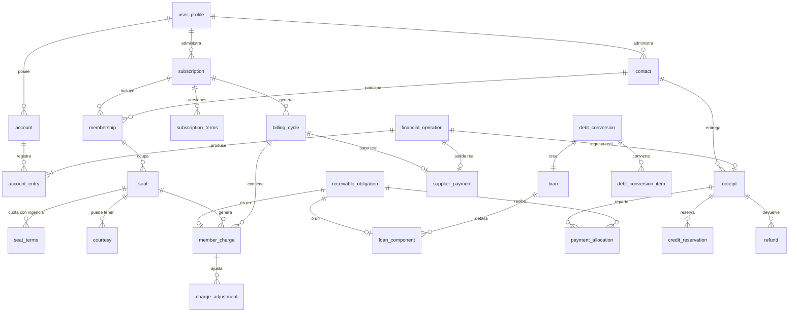

# 12 — Modelo de datos (PostgreSQL)

SQL de las **Entregas 1 y 2**. Es la **fuente de verdad del esquema** (decisión T-03): se divide en archivos de migración numerados e inmutables. Pensado para PostgreSQL con la extensión `btree_gist` (disponible en Supabase).

> **Verificado el 14-oct-2026 (Entrega 0):** este SQL se aplicó desde una base vacía en PostgreSQL 18.4 sin errores de sintaxis (31 tablas, 4 vistas, 18 disparadores, 3 restricciones de exclusión, 45 claves foráneas compuestas) y 22 pruebas de integración confirman sus invariantes (`EVA-Backend/test/integration/schema.test.ts`). Única corrección: las vistas devolvían `0` en lugar de `0.00` cuando no había filas; ahora usan `0.00`. Las migraciones de `EVA-Backend/migrations/` se **generan desde este documento** y deben mantenerse sincronizadas; una vez desplegadas se editan solo con migraciones nuevas.

## 1. Convenciones del esquema

| Convención | Detalle |
| --- | --- |
| Propietario | Toda tabla privada tiene `owner_id` y cada tabla padre expone `UNIQUE (owner_id, id)`. Las FK hijas son **compuestas** `(owner_id, parent_id)`: no se puede apuntar a un registro de otro usuario. |
| Dinero | `numeric(14,2)`; la moneda es `char(3)` con `CHECK (… = 'PEN')` que se relaja en la E7. |
| Estados | `text` + `CHECK`. |
| Fechas | `date` para cobertura/vencimiento; `timestamptz` para auditoría. |
| Versión | `version int` + `updated_at` mantenidos por disparador; el servidor actualiza con `WHERE id = $1 AND version = $2`. |
| Inmutables | `account_entry` y `audit_event` no admiten `UPDATE` ni `DELETE`. |
| No borrar | Archivar con `status`; las FK no usan `ON DELETE CASCADE` hacia datos financieros. |

### Orden de migraciones

| Archivo | Contenido |
| --- | --- |
| `0001_extensions_and_helpers.sql` | extensiones y funciones auxiliares |
| `0002_core_identity_accounts.sql` | usuario, contactos, cuentas, categorías, operaciones, asientos |
| `0003_subscriptions.sql` | servicios, términos, ciclos, participaciones, plazas |
| `0004_billing.sql` | obligaciones, cargos, ajustes, cobros, aplicaciones, reservas, devoluciones, pago al proveedor |
| `0005_audit_idempotency.sql` | auditoría e idempotencia |
| `0006_views_and_invariants.sql` | vistas y disparadores de invariantes (E1) |
| `0207_e3_reconciliation.sql` | **E3.7.** `reconciliation` (saldo registrado, real, diferencia y ajuste). **Escrita a mano** |
| `0301_e4_capture.sql` | **E4.1.** `inbox_address`, `source_document`, `extraction_run`, `usage_record`, `movement_proposal`, `duplicate_candidate`, `evidence_link`, `sender_rule`. Deduplicación por hash de contenido y por id de mensaje; una dirección activa por usuario |
| `0302_e4_occurred_time.sql` | **E4.1.** `occurred_time` (hora local opcional) en `financial_operation` y `movement_proposal`. La fecha manda en reglas y reportes; la hora afina duplicados (24 h reales) |
| `0303_e4_analysis.sql` | **E4.2.** `analysis_request`, `analysis_result`, `chat_session`, `chat_message`. Guardar es opcional; borrar un chat elimina sus mensajes |
| `0304_e4_bank_loans.sql` | **E4.3.** `bank_loan`, `bank_loan_fact` (datos con origen y vigencia), `bank_loan_installment` (calendario; lo desconocido es NULL), `bank_loan_document` (historial de cambios confirmados), `bank_loan_payment`; estado `loan_document` en `source_document` |
| `0401_e5_reports.sql` | **E5.1.** `report_snapshot`: instantánea inmutable del resumen mensual (parámetros, versión, versión de reglas, hash y números); trigger que impide editarla o borrarla |
| `0402_e5_backups.sql` | **E5.3.** `backup`: registro de cada respaldo (tipo, versión de formato y de esquema, hash, cifrado, manifiesto con filas por tabla y saldos por cuenta); el contenido vive en el almacenamiento privado |
| `0403_e6_exports.sql` | **E6.** `export_job`: registro de cada exportación (periodo, secciones y formato pedidos, estado, filas, archivo y vencimiento) |
| `0404_e6_account_deletion.sql` | **Privacidad.** `deleted_user`: solo el identificador de una cuenta eliminada (sin datos personales), para que un token vigente no recree un perfil vacío; se borra a los 7 días |
| `0206_e3_recurring.sql` | **E3.6.** `recurring_template` y `expected_occurrence` (UNIQUE plantilla+fecha: generación idempotente). **Escrita a mano** |
| `0205_e3_goals.sql` | **E3.5.** `goal` y `goal_contribution` (aportes firmados por cuenta: `reserve`, `release`, `transfer`, `spend`). Reservar no crea operaciones. **Escrita a mano** |
| `0204_e3_budgets.sql` | **E3.4.** `budget`, `budget_limit` (versiones del límite), `budget_threshold` y `subscription.category_id` (el pago al proveedor hereda la categoría del servicio). **Escrita a mano** |
| `0203_e3_loans.sql` | **E3.3.** `financial_operation.concept` (`ordinary`/`loan_disbursement`/`loan_payment`/`reconciliation`), `loan` ampliada (sentido `lent`/`borrowed`, interés, forma de devolución, motor `components`/`ledger`) y el libro de cargos: `loan_charge`, `loan_payment`, `loan_allocation`, `loan_capitalization`. **Escrita a mano** |
| `0202_e3_cards.sql` | **E3.2.** `credit_account_details`, `card_statement`, `card_statement_payment`, `card_installment_plan`, `card_installment`. La tarjeta sigue siendo una cuenta de tipo crédito con un solo saldo. **Escrita a mano** |
| `0201_e3_classification.sql` | **E3.1.** `classification_rule` (una fila con condiciones opcionales y acción, en vez de tres tablas) y `classification_decision` (rastro de qué regla o persona clasificó). **Escrita a mano** |
| `0008_effective_due.sql` | Vista `v_charge_due`: vencimiento efectivo de un cargo (un cargo pagado con un ajuste positivo vence cuando vence el ajuste). **Escrita a mano** (E2) |
| `0007_cycle_emission_flag.sql` | `billing_cycle.emit_charges`: marca los ciclos futuros emitidos a propósito para anticipos (D-08). **Escrita a mano**, no se genera desde este documento |
| `0101_e2_courtesy_calendar_loans.sql` | cortesías, cambios de calendario, préstamos, conversiones; reemplaza vistas |

## 2. `0001` — extensiones y funciones auxiliares

```sql
create extension if not exists btree_gist;

create or replace function touch_row() returns trigger language plpgsql as $$
begin
  new.updated_at := now();
  new.version    := old.version + 1;
  return new;
end $$;

create or replace function forbid_mutation() returns trigger language plpgsql as $$
begin
  raise exception 'IMMUTABLE_ROW: % no admite % (use una reversión)', tg_table_name, tg_op
    using errcode = 'restrict_violation';
end $$;
```

## 3. `0002` — identidad, cuentas y operaciones

```sql
create table user_profile (
  id                 uuid primary key,                     -- = id del usuario en Supabase Auth
  display_name       text        not null,
  email              text,
  timezone           text        not null default 'America/Lima',
  currency           char(3)     not null default 'PEN' check (currency = 'PEN'),
  default_free_days  int         not null default 0 check (default_free_days >= 0),   -- g predeterminado
  exit_days_limit    int         check (exit_days_limit >= 0),                        -- L; NULL = siempre termina el ciclo
  preferences        jsonb       not null default '{}',
  created_at         timestamptz not null default now(),
  updated_at         timestamptz not null default now(),
  version            int         not null default 1
);
create trigger user_profile_touch before update on user_profile
  for each row execute function touch_row();

create table contact (
  id          uuid primary key default gen_random_uuid(),
  owner_id    uuid        not null references user_profile(id),
  name        text        not null check (length(btrim(name)) > 0),
  phone       text,
  email       text,
  color       text,
  notes       text,
  status      text        not null default 'active' check (status in ('active','archived')),
  created_at  timestamptz not null default now(),
  updated_at  timestamptz not null default now(),
  version     int         not null default 1,
  unique (owner_id, id)
);
create index contact_owner_status_idx on contact (owner_id, status);
create trigger contact_touch before update on contact for each row execute function touch_row();

create table account (
  id                 uuid primary key default gen_random_uuid(),
  owner_id           uuid        not null references user_profile(id),
  name               text        not null check (length(btrim(name)) > 0),
  type               text        not null check (type in ('bank','savings','cash','wallet','credit')),
  currency           char(3)     not null default 'PEN' check (currency = 'PEN'),
  institution        text,
  color              text,
  icon               text,
  is_default         boolean     not null default false,
  exclude_from_total boolean     not null default false,
  status             text        not null default 'active' check (status in ('active','archived')),
  created_at         timestamptz not null default now(),
  updated_at         timestamptz not null default now(),
  version            int         not null default 1,
  unique (owner_id, id)
);
create index account_owner_status_idx on account (owner_id, status);
create unique index account_one_default_uq on account (owner_id) where is_default and status = 'active';
create trigger account_touch before update on account for each row execute function touch_row();

create table payment_channel (
  id                 uuid primary key default gen_random_uuid(),
  owner_id           uuid not null references user_profile(id),
  name               text not null,                      -- 'Yape', 'Plin', 'Tarjeta digital X'
  linked_account_id  uuid not null,
  status             text not null default 'active' check (status in ('active','archived')),
  created_at         timestamptz not null default now(),
  unique (owner_id, id),
  unique (owner_id, name),
  foreign key (owner_id, linked_account_id) references account (owner_id, id)
);

create table category (
  id          uuid primary key default gen_random_uuid(),
  owner_id    uuid        not null references user_profile(id),
  parent_id   uuid,
  name        text        not null check (length(btrim(name)) > 0),
  icon        text,
  color       text,
  status      text        not null default 'active' check (status in ('active','archived')),
  created_at  timestamptz not null default now(),
  updated_at  timestamptz not null default now(),
  version     int         not null default 1,
  unique (owner_id, id),
  foreign key (owner_id, parent_id) references category (owner_id, id)
);
-- Nombre único por nivel (dos niveles máximo se valida en la aplicación: D-29)
create unique index category_name_uq on category
  (owner_id, coalesce(parent_id, '00000000-0000-0000-0000-000000000000'::uuid), lower(name));
create trigger category_touch before update on category for each row execute function touch_row();

create table financial_operation (
  id             uuid primary key default gen_random_uuid(),
  owner_id       uuid        not null references user_profile(id),
  kind           text        not null check (kind in ('opening','income','expense','transfer','adjustment','reversal')),
  occurred_on    date        not null,
  description    text        not null default '',
  contact_id     uuid,
  category_id    uuid,
  source         text        not null default 'manual' check (source in ('manual','email','photo','recurring','system')),
  status         text        not null default 'confirmed' check (status in ('confirmed','reversed')),
  reversal_of_id uuid,
  reason         text,
  created_by     uuid        not null,
  created_at     timestamptz not null default now(),
  updated_at     timestamptz not null default now(),
  version        int         not null default 1,
  unique (owner_id, id),
  foreign key (owner_id, contact_id)     references contact  (owner_id, id),
  foreign key (owner_id, category_id)    references category (owner_id, id),
  foreign key (owner_id, reversal_of_id) references financial_operation (owner_id, id),
  check ((kind = 'reversal') = (reversal_of_id is not null)),
  check (kind <> 'reversal' or reason is not null)
);
create index fin_op_owner_date_idx on financial_operation (owner_id, occurred_on desc);
create trigger fin_op_touch before update on financial_operation for each row execute function touch_row();

-- Efecto firmado sobre una cuenta. Saldo = suma de asientos. Inmutable.
create table account_entry (
  id            uuid primary key default gen_random_uuid(),
  owner_id      uuid          not null references user_profile(id),
  operation_id  uuid          not null,
  account_id    uuid          not null,
  amount        numeric(14,2) not null check (amount <> 0),
  currency      char(3)       not null default 'PEN' check (currency = 'PEN'),
  created_at    timestamptz   not null default now(),
  unique (owner_id, id),
  foreign key (owner_id, operation_id) references financial_operation (owner_id, id),
  foreign key (owner_id, account_id)   references account (owner_id, id)
);
create index account_entry_account_idx   on account_entry (owner_id, account_id);
create index account_entry_operation_idx on account_entry (operation_id);
create trigger account_entry_immutable before update or delete on account_entry
  for each row execute function forbid_mutation();

-- Desglose de una operación por concepto/categoría. Σ items = total (se valida en la aplicación
-- y con el disparador de §8 en la E3). No es un gasto adicional.
create table operation_item (
  id            uuid primary key default gen_random_uuid(),
  owner_id      uuid          not null references user_profile(id),
  operation_id  uuid          not null,
  category_id   uuid,
  concept       text          not null,
  amount        numeric(14,2) not null check (amount > 0),
  foreign key (owner_id, operation_id) references financial_operation (owner_id, id),
  foreign key (owner_id, category_id)  references category (owner_id, id)
);
create index operation_item_op_idx on operation_item (operation_id);
```

### Disparador de equilibrio de operaciones

```sql
-- Se evalúa al confirmar la transacción (diferido), cuando ya existen todos los asientos.
create or replace function check_operation_entries() returns trigger language plpgsql as $$
declare v_kind text; v_sum numeric; v_cnt int;
begin
  select kind into v_kind from financial_operation where id = new.operation_id;
  select coalesce(sum(amount),0), count(*) into v_sum, v_cnt
    from account_entry where operation_id = new.operation_id;

  if v_kind = 'transfer'   and (v_cnt <> 2 or v_sum <> 0)  then raise exception 'OPERATION_TRANSFER_UNBALANCED'  using errcode = 'check_violation'; end if;
  if v_kind = 'income'     and v_sum <= 0                  then raise exception 'OPERATION_INCOME_NOT_POSITIVE'  using errcode = 'check_violation'; end if;
  if v_kind = 'expense'    and v_sum >= 0                  then raise exception 'OPERATION_EXPENSE_NOT_NEGATIVE' using errcode = 'check_violation'; end if;
  if v_kind in ('opening','adjustment') and v_cnt <> 1     then raise exception 'OPERATION_SINGLE_ENTRY_REQUIRED' using errcode = 'check_violation'; end if;
  return null;
end $$;

create constraint trigger account_entry_check_op
  after insert on account_entry deferrable initially deferred
  for each row execute function check_operation_entries();
```

> `income` con un asiento negativo en una tarjeta de crédito (pagar la tarjeta recibe un asiento positivo en la tarjeta dentro de una `transfer`) no se confunde: pagar una tarjeta **es una transferencia** (banco −X, tarjeta +X).

## 4. `0003` — servicios, calendario y plazas

```sql
create table subscription (
  id                    uuid primary key default gen_random_uuid(),
  owner_id              uuid        not null references user_profile(id),
  name                  text        not null check (length(btrim(name)) > 0),
  provider              text,
  mode                  text        not null check (mode in ('personal','shared')),
  capacity              int         not null check (capacity >= 1),
  preferred_account_id  uuid,
  color                 text,
  icon                  text,
  status                text        not null default 'active' check (status in ('active','suspended','archived')),
  currency              char(3)     not null default 'PEN' check (currency = 'PEN'),
  created_at            timestamptz not null default now(),
  updated_at            timestamptz not null default now(),
  version               int         not null default 1,
  unique (owner_id, id),
  foreign key (owner_id, preferred_account_id) references account (owner_id, id),
  check (mode <> 'personal' or capacity = 1)
);
create index subscription_owner_status_idx on subscription (owner_id, status);
create trigger subscription_touch before update on subscription for each row execute function touch_row();

-- Versiones del precio y calendario con vigencia [valid_from, valid_to)
create table subscription_terms (
  id               uuid primary key default gen_random_uuid(),
  owner_id         uuid          not null references user_profile(id),
  subscription_id  uuid          not null,
  valid_from       date          not null,
  valid_to         date,
  announced_price  numeric(14,2) not null check (announced_price >= 0),
  interval_unit    text          not null check (interval_unit in ('day','week','month','year')),
  interval_count   int           not null check (interval_count >= 1),
  anchor_date      date          not null,                  -- última fecha confirmada por el proveedor
  reason           text,
  created_by       uuid          not null,
  created_at       timestamptz   not null default now(),
  unique (owner_id, id),
  foreign key (owner_id, subscription_id) references subscription (owner_id, id),
  check (valid_to is null or valid_to > valid_from),
  exclude using gist (subscription_id with =, daterange(valid_from, valid_to, '[)') with &&)
);

create table billing_cycle (
  id               uuid primary key default gen_random_uuid(),
  owner_id         uuid        not null references user_profile(id),
  subscription_id  uuid        not null,
  seq              int         not null check (seq >= 1),
  start_date       date        not null,
  end_date         date        not null,                    -- excluido
  terms_id         uuid,
  terms_snapshot   jsonb       not null,                    -- { announcedPrice, interval, anchor, baseDays }
  created_at       timestamptz not null default now(),
  unique (owner_id, id),
  unique (subscription_id, start_date),
  unique (subscription_id, seq),
  foreign key (owner_id, subscription_id) references subscription (owner_id, id),
  foreign key (owner_id, terms_id)        references subscription_terms (owner_id, id),
  check (end_date > start_date),
  exclude using gist (subscription_id with =, daterange(start_date, end_date, '[)') with &&)
);
create index billing_cycle_sub_start_idx on billing_cycle (subscription_id, start_date desc);

create table membership (
  id                  uuid primary key default gen_random_uuid(),
  owner_id            uuid        not null references user_profile(id),
  subscription_id     uuid        not null,
  contact_id          uuid,
  is_owner            boolean     not null default false,
  start_date          date        not null,
  end_date            date,
  scheduled_end_date  date,                                 -- baja programada (E2)
  status              text        not null default 'active' check (status in ('active','ending','ended')),
  end_reason          text,
  created_at          timestamptz not null default now(),
  updated_at          timestamptz not null default now(),
  version             int         not null default 1,
  unique (owner_id, id),
  unique (owner_id, id, subscription_id),
  foreign key (owner_id, subscription_id) references subscription (owner_id, id),
  foreign key (owner_id, contact_id)      references contact (owner_id, id),
  check ((is_owner and contact_id is null) or (not is_owner and contact_id is not null)),
  check (end_date is null or end_date >= start_date)
);
create unique index membership_owner_uq   on membership (subscription_id) where is_owner and status <> 'ended';
create unique index membership_contact_uq on membership (subscription_id, contact_id)
  where not is_owner and status <> 'ended';
create trigger membership_touch before update on membership for each row execute function touch_row();

create table seat (
  id               uuid primary key default gen_random_uuid(),
  owner_id         uuid        not null references user_profile(id),
  membership_id    uuid        not null,
  subscription_id  uuid        not null,
  label            text        not null,                    -- 'Cuenta 1', 'Pantalla 2'
  start_date       date        not null,
  end_date         date,
  created_at       timestamptz not null default now(),
  unique (owner_id, id),
  foreign key (owner_id, membership_id, subscription_id) references membership (owner_id, id, subscription_id),
  check (end_date is null or end_date >= start_date)
);
create index seat_sub_idx on seat (subscription_id) where end_date is null;

create table seat_terms (
  id                    uuid primary key default gen_random_uuid(),
  owner_id              uuid          not null references user_profile(id),
  seat_id               uuid          not null,
  valid_from            date          not null,
  valid_to              date,
  quota                 numeric(14,2) not null check (quota >= 0),
  free_days_threshold   int           check (free_days_threshold >= 0),   -- excepción de g para esta plaza
  reason                text,
  created_by            uuid          not null,
  created_at            timestamptz   not null default now(),
  unique (owner_id, id),
  foreign key (owner_id, seat_id) references seat (owner_id, id),
  check (valid_to is null or valid_to > valid_from),
  exclude using gist (seat_id with =, daterange(valid_from, valid_to, '[)') with &&)
);
```

**Capacidad** (RN-S03): se valida en la aplicación dentro de la transacción de alta de plaza, con `SELECT … FROM subscription WHERE id = $1 FOR UPDATE`, contando plazas activas a la fecha de ingreso (`start_date ≤ d AND (end_date IS NULL OR end_date > d)`). Una restricción puramente declarativa no la expresa; la prueba A28 cubre la concurrencia.

## 5. `0004` — cargos, cobros y pagos

```sql
-- Clave común de todo lo que un contacto debe al administrador
create table receivable_obligation (
  id          uuid primary key default gen_random_uuid(),
  owner_id    uuid        not null references user_profile(id),
  contact_id  uuid        not null,
  kind        text        not null check (kind in ('subscription_charge','loan_component')),
  currency    char(3)     not null default 'PEN' check (currency = 'PEN'),
  created_at  timestamptz not null default now(),
  unique (owner_id, id),
  unique (owner_id, id, contact_id),
  foreign key (owner_id, contact_id) references contact (owner_id, id)
);
create index obligation_contact_idx on receivable_obligation (owner_id, contact_id);

create table member_charge (
  obligation_id      uuid primary key,
  owner_id           uuid          not null,
  contact_id         uuid          not null,
  seat_id            uuid          not null,
  cycle_id           uuid          not null,
  due_date           date          not null,
  quota_snapshot     numeric(14,2) not null,
  gross_amount       numeric(14,2) not null check (gross_amount >= 0),
  exemption_amount   numeric(14,2) not null default 0 check (exemption_amount >= 0),
  net_amount         numeric(14,2) generated always as (gross_amount - exemption_amount) stored,
  mode               text          not null check (mode in ('full_cycle','trial_free','partial_charged','courtesy','manual')),
  calc_snapshot      jsonb         not null,                -- r, B, g, prorrateo, regla@versión, redondeo
  status             text          not null default 'issued' check (status in ('issued','void')),
  void_reason        text,
  voided_at          timestamptz,
  created_at         timestamptz   not null default now(),
  check (exemption_amount <= gross_amount),
  check (status = 'issued' or void_reason is not null),
  foreign key (owner_id, obligation_id, contact_id) references receivable_obligation (owner_id, id, contact_id),
  foreign key (owner_id, seat_id)  references seat (owner_id, id),
  foreign key (owner_id, cycle_id) references billing_cycle (owner_id, id),
  unique (seat_id, cycle_id)                                -- un cargo por plaza y ciclo (RN-CH01)
);
create index member_charge_due_idx   on member_charge (owner_id, due_date) where status = 'issued';
create index member_charge_cycle_idx on member_charge (cycle_id);

create table charge_adjustment (
  id             uuid primary key default gen_random_uuid(),
  owner_id       uuid          not null references user_profile(id),
  obligation_id  uuid          not null,
  amount         numeric(14,2) not null check (amount <> 0),   -- firmado: + aumenta, − descuenta
  kind           text          not null check (kind in ('quota_change','early_exit','manual','forgiveness','other')),
  due_date       date,
  group_id       uuid,                                          -- agrupa diferencias "juntas"
  reason         text          not null,
  status         text          not null default 'active' check (status in ('active','void')),
  created_by     uuid          not null,
  created_at     timestamptz   not null default now(),
  voided_at      timestamptz,
  foreign key (owner_id, obligation_id) references receivable_obligation (owner_id, id)
);
create index charge_adjustment_obl_idx on charge_adjustment (obligation_id) where status = 'active';

-- Un cobro = UN ingreso real. Su reparto está en payment_allocation.
create table receipt (
  id            uuid primary key default gen_random_uuid(),
  owner_id      uuid          not null references user_profile(id),
  contact_id    uuid          not null,
  operation_id  uuid          not null unique,
  amount        numeric(14,2) not null check (amount > 0),
  received_on   date          not null,
  note          text,
  status        text          not null default 'active' check (status in ('active','reversed')),
  created_at    timestamptz   not null default now(),
  updated_at    timestamptz   not null default now(),
  version       int           not null default 1,
  unique (owner_id, id),
  foreign key (owner_id, contact_id)   references contact (owner_id, id),
  foreign key (owner_id, operation_id) references financial_operation (owner_id, id)
);
create index receipt_contact_idx on receipt (owner_id, contact_id, received_on desc);
create trigger receipt_touch before update on receipt for each row execute function touch_row();

create table payment_allocation (
  id               uuid primary key default gen_random_uuid(),
  owner_id         uuid          not null references user_profile(id),
  receipt_id       uuid          not null,
  obligation_id    uuid          not null,
  amount           numeric(14,2) not null check (amount > 0),
  origin           text          not null default 'manual' check (origin in ('manual','reservation','system')),
  status           text          not null default 'active' check (status in ('active','released')),
  released_reason  text,
  released_at      timestamptz,
  created_by       uuid          not null,
  created_at       timestamptz   not null default now(),
  foreign key (owner_id, receipt_id)    references receipt (owner_id, id),
  foreign key (owner_id, obligation_id) references receivable_obligation (owner_id, id),
  check (status = 'active' or released_reason is not null)
);
create index alloc_receipt_idx    on payment_allocation (receipt_id)    where status = 'active';
create index alloc_obligation_idx on payment_allocation (obligation_id) where status = 'active';

-- Anticipo: dinero sin aplicar con destino por defecto. No crea dinero ni garantiza precio.
create table credit_reservation (
  id                      uuid primary key default gen_random_uuid(),
  owner_id                uuid          not null references user_profile(id),
  receipt_id              uuid          not null,
  target_subscription_id  uuid          not null,
  amount                  numeric(14,2) not null check (amount >= 0),
  status                  text          not null default 'active' check (status in ('active','consumed','released')),
  note                    text,
  created_at              timestamptz   not null default now(),
  updated_at              timestamptz   not null default now(),
  version                 int           not null default 1,
  foreign key (owner_id, receipt_id)             references receipt (owner_id, id),
  foreign key (owner_id, target_subscription_id) references subscription (owner_id, id),
  check (status <> 'active' or amount > 0)
);
create index reservation_receipt_idx on credit_reservation (receipt_id) where status = 'active';
create trigger reservation_touch before update on credit_reservation for each row execute function touch_row();

-- Devolución: solicitada/programada ≠ dinero ya devuelto (RN-X06)
create table refund (
  id            uuid primary key default gen_random_uuid(),
  owner_id      uuid          not null references user_profile(id),
  receipt_id    uuid          not null,
  contact_id    uuid          not null,
  amount        numeric(14,2) not null check (amount > 0),
  status        text          not null default 'planned' check (status in ('planned','paid','cancelled')),
  planned_on    date,
  operation_id  uuid          unique,                        -- salida real cuando status = 'paid'
  reason        text          not null,
  created_at    timestamptz   not null default now(),
  updated_at    timestamptz   not null default now(),
  version       int           not null default 1,
  foreign key (owner_id, receipt_id)   references receipt (owner_id, id),
  foreign key (owner_id, contact_id)   references contact (owner_id, id),
  foreign key (owner_id, operation_id) references financial_operation (owner_id, id),
  check (status <> 'paid' or operation_id is not null)
);
create trigger refund_touch before update on refund for each row execute function touch_row();

create table supplier_payment (
  id                        uuid primary key default gen_random_uuid(),
  owner_id                  uuid          not null references user_profile(id),
  cycle_id                  uuid          not null,
  operation_id              uuid          not null unique,
  amount_real               numeric(14,2) not null check (amount_real > 0),
  announced_price_snapshot  numeric(14,2) not null,
  paid_on                   date          not null,
  status                    text          not null default 'active' check (status in ('active','reversed')),
  created_at                timestamptz   not null default now(),
  unique (owner_id, id),
  foreign key (owner_id, cycle_id)     references billing_cycle (owner_id, id),
  foreign key (owner_id, operation_id) references financial_operation (owner_id, id)
);
create unique index supplier_payment_active_uq on supplier_payment (cycle_id) where status = 'active';
```

## 6. `0005` — auditoría e idempotencia

```sql
create table audit_event (
  id           uuid primary key default gen_random_uuid(),
  owner_id     uuid        not null references user_profile(id),
  actor_id     uuid        not null,
  action       text        not null,                     -- 'receipt.create', 'allocation.release', …
  entity_type  text        not null,
  entity_id    uuid        not null,
  reason       text,
  changes      jsonb,                                    -- solo campos pertinentes; sin secretos ni correos
  at           timestamptz not null default now()
);
create index audit_entity_idx on audit_event (owner_id, entity_type, entity_id);
create index audit_at_idx     on audit_event (owner_id, at desc);
create trigger audit_event_immutable before update or delete on audit_event
  for each row execute function forbid_mutation();

-- Un reintento con la misma clave devuelve el resultado ya guardado
create table idempotency_record (
  owner_id         uuid        not null references user_profile(id),
  key              text        not null check (length(key) between 8 and 128),
  endpoint         text        not null,
  request_hash     text        not null,
  response_status  int         not null,
  response_body    jsonb       not null,
  created_at       timestamptz not null default now(),
  primary key (owner_id, key)
);
-- Se purgan registros con más de 7 días (tarea periódica).
```

## 7. `0006` — vistas e invariantes (E1)

```sql
create view v_account_balance as
select e.owner_id, e.account_id, sum(e.amount) as balance
from account_entry e
group by e.owner_id, e.account_id;

create view v_obligation_balance as
select o.id as obligation_id, o.owner_id, o.contact_id, o.kind,
       b.amount                         as issued_amount,
       coalesce(adj.total, 0.00)           as adjustments_total,
       coalesce(al.total, 0.00)            as applied_total,
       0.00::numeric                       as converted_total,
       b.amount + coalesce(adj.total, 0.00) - coalesce(al.total, 0.00) as pending_amount
from receivable_obligation o
join lateral (
  select mc.net_amount as amount
  from member_charge mc
  where mc.obligation_id = o.id and mc.status = 'issued'
) b on true
left join lateral (
  select sum(a.amount) as total from charge_adjustment a
  where a.obligation_id = o.id and a.status = 'active'
) adj on true
left join lateral (
  select sum(p.amount) as total from payment_allocation p
  where p.obligation_id = o.id and p.status = 'active'
) al on true;

create view v_receipt_availability as
select r.id as receipt_id, r.owner_id, r.contact_id,
       r.amount                                           as received,
       coalesce(al.total, 0.00)                              as applied,
       coalesce(rf.total, 0.00)                              as refunded,
       r.amount - coalesce(al.total, 0.00) - coalesce(rf.total, 0.00)                           as unapplied,
       coalesce(rs.total, 0.00)                              as reserved,
       r.amount - coalesce(al.total, 0.00) - coalesce(rf.total, 0.00) - coalesce(rs.total, 0.00)   as free
from receipt r
left join lateral (select sum(amount) total from payment_allocation
                   where receipt_id = r.id and status = 'active') al on true
left join lateral (select sum(amount) total from refund
                   where receipt_id = r.id and status in ('planned','paid')) rf on true
left join lateral (select sum(amount) total from credit_reservation
                   where receipt_id = r.id and status = 'active') rs on true
where r.status = 'active';

create view v_charge_status as
select b.*, mc.due_date, mc.seat_id, mc.cycle_id,
       case
         when b.issued_amount + b.adjustments_total = 0                   then 'exempt'
         when b.converted_total > 0 and b.pending_amount = 0              then 'converted'
         when b.pending_amount = 0                                        then 'paid'
         when b.applied_total = 0                                         then 'unpaid'
         else 'partial'
       end as payment_status
from v_obligation_balance b
join member_charge mc on mc.obligation_id = b.obligation_id;
```

### Disparador de invariantes de aplicación

Cinturón y tirantes: la aplicación valida y bloquea, y la base **rechaza** cualquier estado imposible aunque exista un error de código.

```sql
create or replace function check_allocation_invariants() returns trigger language plpgsql as $$
declare v_rc receipt%rowtype; v_ob_contact uuid; v_applied numeric; v_refunded numeric; v_pending numeric;
begin
  if new.status <> 'active' then return null; end if;

  select * into v_rc from receipt where id = new.receipt_id;
  if v_rc.status <> 'active' then
    raise exception 'ALLOCATION_RECEIPT_NOT_ACTIVE' using errcode = 'check_violation';
  end if;

  select contact_id into v_ob_contact from receivable_obligation where id = new.obligation_id;
  if v_ob_contact <> v_rc.contact_id then
    raise exception 'ALLOCATION_CONTACT_MISMATCH' using errcode = 'check_violation';
  end if;

  select coalesce(sum(amount),0) into v_applied  from payment_allocation where receipt_id = new.receipt_id and status = 'active';
  select coalesce(sum(amount),0) into v_refunded from refund where receipt_id = new.receipt_id and status in ('planned','paid');
  if v_applied + v_refunded > v_rc.amount then
    raise exception 'ALLOCATION_EXCEEDS_RECEIPT' using errcode = 'check_violation';
  end if;

  select pending_amount into v_pending from v_obligation_balance where obligation_id = new.obligation_id;
  if v_pending is null or v_pending < 0 then
    raise exception 'ALLOCATION_EXCEEDS_OBLIGATION' using errcode = 'check_violation';
  end if;
  return null;
end $$;

create constraint trigger payment_allocation_invariants
  after insert or update on payment_allocation deferrable initially deferred
  for each row execute function check_allocation_invariants();
```

Una devolución que supere lo no aplicado se rechaza de forma análoga (disparador sobre `refund`, mismo patrón).

## 8. `0101` — Entrega 2

```sql
create table courtesy (
  id           uuid primary key default gen_random_uuid(),
  owner_id     uuid        not null references user_profile(id),
  seat_id      uuid        not null,
  kind         text        not null check (kind in ('cycles','until_date','permanent')),
  starts_on    date        not null,
  until_date   date,
  cycles_total int,
  cycles_used  int         not null default 0,
  reason       text        not null,
  status       text        not null default 'active' check (status in ('active','ended')),
  created_by   uuid        not null,
  created_at   timestamptz not null default now(),
  ended_at     timestamptz,
  foreign key (owner_id, seat_id) references seat (owner_id, id),
  check ((kind = 'cycles'     and cycles_total >= 1)
      or (kind = 'until_date' and until_date is not null)
      or (kind = 'permanent'))
);

create table calendar_change (
  id                 uuid primary key default gen_random_uuid(),
  owner_id           uuid        not null references user_profile(id),
  subscription_id    uuid        not null,
  kind               text        not null check (kind in ('shift_renewal','change_interval','suspend','reactivate','advance_renewal')),
  effective_on       date        not null,
  before_terms_id    uuid,
  after_terms_id     uuid,
  old_current_end    date,
  new_current_end    date,
  reason             text        not null,
  preview            jsonb       not null,                -- ciclos y cargos afectados tal como se mostró
  confirmed_by       uuid        not null,
  created_at         timestamptz not null default now(),
  foreign key (owner_id, subscription_id) references subscription (owner_id, id)
);

-- E2: solo préstamos OTORGADOS a un contacto (por conversión de deuda o manuales). E3 amplía.
create table loan (
  id                         uuid primary key default gen_random_uuid(),
  owner_id                   uuid          not null references user_profile(id),
  contact_id                 uuid          not null,
  direction                  text          not null default 'lent' check (direction in ('lent')),
  principal                  numeric(14,2) not null check (principal > 0),
  currency                   char(3)       not null default 'PEN' check (currency = 'PEN'),
  opened_on                  date          not null,
  origin                     text          not null check (origin in ('manual','debt_conversion')),
  interest_mode              text          not null default 'none' check (interest_mode in ('none')),
  disbursement_operation_id  uuid,                           -- solo si el dinero salió de una cuenta propia
  status                     text          not null default 'open' check (status in ('open','closed','cancelled')),
  note                       text,
  created_at                 timestamptz   not null default now(),
  updated_at                 timestamptz   not null default now(),
  version                    int           not null default 1,
  unique (owner_id, id),
  foreign key (owner_id, contact_id) references contact (owner_id, id),
  foreign key (owner_id, disbursement_operation_id) references financial_operation (owner_id, id)
);
create trigger loan_touch before update on loan for each row execute function touch_row();

create table loan_component (
  obligation_id         uuid primary key,
  owner_id              uuid          not null,
  contact_id            uuid          not null,
  loan_id               uuid          not null,
  concept               text          not null,             -- 'Netflix — plaza 1'
  period_label          text,                               -- 'ciclo 4-mar → 4-abr'
  origin_obligation_id  uuid,                               -- cargo de origen (trazabilidad)
  amount                numeric(14,2) not null check (amount > 0),
  due_date              date,
  created_at            timestamptz   not null default now(),
  foreign key (owner_id, obligation_id, contact_id) references receivable_obligation (owner_id, id, contact_id),
  foreign key (owner_id, loan_id)              references loan (owner_id, id),
  foreign key (owner_id, origin_obligation_id) references receivable_obligation (owner_id, id)
);

create table debt_conversion (
  id            uuid primary key default gen_random_uuid(),
  owner_id      uuid        not null references user_profile(id),
  contact_id    uuid        not null,
  loan_id       uuid        not null unique,
  converted_on  date        not null,
  trigger       text        not null check (trigger in ('exit','individual_switch','courtesy_choice','manual')),
  reason        text        not null,
  created_by    uuid        not null,
  created_at    timestamptz not null default now(),
  unique (owner_id, id),
  foreign key (owner_id, contact_id) references contact (owner_id, id),
  foreign key (owner_id, loan_id)    references loan (owner_id, id)
);

create table debt_conversion_item (
  id                    uuid primary key default gen_random_uuid(),
  owner_id              uuid          not null references user_profile(id),
  conversion_id         uuid          not null,
  source_obligation_id  uuid          not null,
  target_obligation_id  uuid          not null,
  amount                numeric(14,2) not null check (amount > 0),
  status                text          not null default 'active' check (status in ('active','void')),
  foreign key (owner_id, conversion_id)        references debt_conversion (owner_id, id),
  foreign key (owner_id, source_obligation_id) references receivable_obligation (owner_id, id),
  foreign key (owner_id, target_obligation_id) references receivable_obligation (owner_id, id),
  unique (conversion_id, source_obligation_id)
);

-- Las conversiones reducen el pendiente de origen y el componente nuevo lo abre: la deuda total no cambia.
create or replace view v_obligation_balance as
select o.id as obligation_id, o.owner_id, o.contact_id, o.kind,
       b.amount                         as issued_amount,
       coalesce(adj.total, 0.00)           as adjustments_total,
       coalesce(al.total, 0.00)            as applied_total,
       coalesce(cv.total, 0.00)            as converted_total,
       b.amount + coalesce(adj.total, 0.00) - coalesce(al.total, 0.00) - coalesce(cv.total, 0.00) as pending_amount
from receivable_obligation o
join lateral (
  select mc.net_amount as amount from member_charge mc
   where mc.obligation_id = o.id and mc.status = 'issued'
  union all
  select lc.amount from loan_component lc where lc.obligation_id = o.id
) b on true
left join lateral (select sum(a.amount) total from charge_adjustment a
                   where a.obligation_id = o.id and a.status = 'active') adj on true
left join lateral (select sum(p.amount) total from payment_allocation p
                   where p.obligation_id = o.id and p.status = 'active') al on true
left join lateral (select sum(i.amount) total from debt_conversion_item i
                   where i.source_obligation_id = o.id and i.status = 'active') cv on true;
```

Notas de la E2: la conversión de **retiro** también deja los ciclos futuros `void` (campo `member_charge.status`) y libera aplicaciones; nada de eso requiere tablas nuevas. Los préstamos **recibidos**, los intereses y los cronogramas llegan en la E3 con `ALTER TABLE` controlado sobre `loan` (ampliar los `CHECK` de `direction` e `interest_mode`).

## 9. Diagrama de relaciones (E1 + E2)



## 10. Extensiones de las Entregas 3 a 7 (resumen)

No se crean tablas vacías por anticipación; cada entrega añade las suyas con una migración. Todas siguen las convenciones de §1.

| Entrega | Tablas previstas | Nota de diseño |
| --- | --- | --- |
| E3 | `classification_rule`, `rule_condition`, `rule_action`, `classification_decision`, `budget`, `budget_period`, `budget_threshold`, `goal`, `goal_reservation`, `goal_contribution`, `recurring_template`, `expected_occurrence`, `reconciliation`, `reconciliation_item`, `loan_terms`, `loan_installment`, `interest_accrual`, `capitalization`, `loan_document`, `schedule_revision`, `credit_account_details`, `card_statement`, `card_purchase`, `card_installment`, `card_payment_allocation`, `payable_obligation` (deudas que EVA debe pagar) | Una aplicación **nunca** apunta a una deuda bancaria por una referencia genérica: los préstamos recibidos usan obligaciones de salida separadas. Disparador de suma de `operation_item`. |
| E4 | `inbox_address`, `source_document`, `source_delivery`, `extraction_run`, `movement_proposal`, `duplicate_candidate`, `evidence_link`, `analysis_request`, `analysis_result`, `chat_session`, `usage_record` | Unicidad real de `inbox_address` en base; deduplicación de reentrega por hash. |
| E5 | `notification_preference`, `reminder`, `delivery_attempt`, `report_definition`, `report_snapshot`, `export_job`, `backup_policy`, `backup_run`, `restore_job`, `dashboard_preference` | `report_snapshot` guarda los números calculados, no solo parámetros. |
| E6–E7 | Cuentas USD, cotizaciones, invitaciones y permisos | Se levanta el `CHECK (currency = 'PEN')` y se añade `exchange_quote`. |

JSON solo para metadatos y resultados de extracción (`calc_snapshot`, `terms_snapshot`, `preview`): **nunca** como reemplazo de cargos, pagos o relaciones.

## 11. Datos iniciales (seed)

Al crear el perfil se insertan categorías sugeridas (Servicios, Comida, Transporte, Tecnología, Salud, Ocio, Hogar, Otros, *Minigastos*) editables y archivables, sin importar saldos ni historial. Para pruebas, `test/fixtures` genera un usuario con las cuentas y contactos de los escenarios A01–A28.
