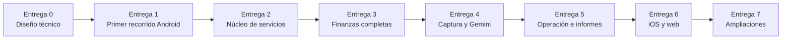

# 15 — Plan de implementación

> **Estado (17-nov-2026): documento histórico de planificación.** Las Entregas 0 a 6 ya están construidas y en producción. El trabajo pendiente vive en [`../PENDIENTES.md`](../PENDIENTES.md). Se conserva por los criterios de aceptación y la trazabilidad `RN`/`A` de cada tarea.

Plan de trabajo desde hoy hasta cerrar la Entrega 1, y el esquema de las siguientes. **No contiene fechas**: depende de tu disponibilidad. Los tamaños son relativos: **S** ≈ medio día · **M** ≈ 1–2 días · **L** ≈ 3–5 días · **XL** = dividir antes de empezar.

## 1. Principios

1. **Recorridos verticales**: cada paso termina con algo que guarda, consulta y corrige, probado de extremo a extremo.
2. **Primero el dominio con pruebas, luego la base, luego la API, luego la pantalla.**
3. **Un solo objetivo inmediato: la Entrega 1.** No se empieza nada de la E2 hasta cerrar la lista de [14 §4](14-casos-de-prueba.md).
4. **Cada tarea cita sus reglas (`RN-xxx`) y sus pruebas (`Axx`/`Mxx`).** Si una tarea no cita ninguna, falta especificación.
5. **No contratar nada** hasta que la E1 funcione con datos reales de prueba.

## 2. Entrega 0 — Diseño técnico

Objetivo: dejar el terreno listo sin escribir lógica de negocio. **Salida:** repositorio del backend con CI en verde, base PostgreSQL local con el esquema aplicado desde cero, y decisiones confirmadas.

| ID | Tarea | Tamaño | Entregable / criterio de salida |
| --- | --- | --- | --- |
| 0.1 | **Revisar y confirmar** las propuestas `D-xx` de [10](10-decisiones.md) (al menos D-01…D-13, D-16, D-17, D-19) y los pendientes de [17](17-trazabilidad-y-pendientes.md) | S | Cada una marcada *confirmada* o corregida |
| 0.2 | Instalar PostgreSQL local (nativa o contenedor) y comprobar `btree_gist` | S | `select 1` desde el proyecto |
| 0.3 | Crear `EVA-Backend` (TypeScript, estructura de [11 §2](11-arquitectura.md)); elegir y **registrar versiones** en el README | M | `npm test` y `npm run typecheck` pasan |
| 0.4 | Prueba de concepto de **T-03** (Kysely + migraciones SQL): aplicar `0001`–`0006`, leer/escribir una fila con FK compuesta | M | Decisión T-03 confirmada o cambiada con motivo |
| 0.5 | **Aplicar el SQL de [12](12-modelo-de-datos.md) desde cero**, corregir errores de sintaxis y anotar cambios en el propio documento | M | Esquema aplicado; script de verificación pasa (M07, M08, M09, M10 básicos) |
| 0.6 | CI del backend (tipos, pruebas con PostgreSQL de servicio, auditoría, aplicar migraciones desde cero, `openapi.json` sin diferencias) | M | Flujo verde en un *pull request* |
| 0.7 | Revisión de interfaz: recorrer las pantallas existentes de `src/screens` y decidir *reutilizar / adaptar / rehacer* | M | Tabla en [16](16-auditoria-del-codigo.md) completada por pantalla |
| 0.8 | **Prototipo de interfaz del primer recorrido** (Pencil o bocetos): crear servicio, vista previa de incorporación, cobro con reparto, estado de cuenta | L | 5 pantallas aprobadas por ti |
| 0.9 | Limpieza del frontend: eliminar `src/api/firebase.ts`, `src/api/gemini.ts`, dependencias `firebase` y `@google/generative-ai`, variables de `.env.example`; archivar `schema.prisma` | S | `npm run typecheck` y `npm test` pasan; no queda referencia a Firebase/Gemini en cliente |
| 0.10 | Si alguna vez hubo una clave real en `.env` o en un commit: **rotarla** | S | Comprobado en el historial de git |
| 0.11 | Configurar Supabase (proyecto *staging* gratis) y verificar JWT en la API local; mantener emisor de JWT local para pruebas | M | `GET /me` devuelve el perfil con un token real |

**Cierre de la Entrega 0:** los documentos 10 y 12 quedan actualizados con lo aprendido (el SQL deja de ser "diseño sin ejecutar").

### Estado de la Entrega 0 (actualizado el 14-oct-2026)

| ID | Estado | Resultado |
| --- | --- | --- |
| 0.1 | **Hecha** | Las 9 preguntas de [17 §3.1](17-trazabilidad-y-pendientes.md) fueron confirmadas el 14-oct-2026 (D-02, D-04, D-06, D-07, D-08, D-09, D-31, D-32 y valores iniciales `g`/`L`). Quedan como propuesta vigente las `D-xx` de la E2 en adelante |
| 0.2 | **Hecha** | PostgreSQL 18.4 en un clúster propio del proyecto (`.pgdata/`, `127.0.0.1:54329`, sin contraseña, solo desarrollo); bases `eva_dev` y `eva_test`. No toca el servicio instalado en el sistema |
| 0.3 | **Hecha** | `EVA-Backend` con TypeScript, Fastify, validación de entorno, `/healthz` y `/readyz`; versiones registradas en su README |
| 0.4 | **Hecha** | Kysely funciona con el esquema: transacciones tipadas, dinero exacto como cadena y rechazo de claves foráneas cruzadas. **T-03 confirmada** (migraciones SQL + Kysely) |
| 0.5 | **Hecha** | SQL aplicado desde cero sin errores de sintaxis; 22 pruebas de invariantes; una corrección menor (ceros de las vistas) |
| 0.6 | **Hecha** (a falta de ejecutarse en GitHub) | `.github/workflows/ci.yml` con PostgreSQL 18 de servicio, tipos, pruebas y auditoría. La comprobación de `openapi.json` se añade en la E1 |
| 0.7 | **Pendiente** | Revisión pantalla por pantalla de la interfaz |
| 0.8 | **Boceto hecho, falta tu aprobación** | Prototipo HTML interactivo de las 5 pantallas en [`prototipo/index.html`](prototipo/index.html) (Pencil no estaba conectado), con la paleta real, modo claro/oscuro y las fórmulas del motor funcionando en vivo |
| 0.9 | **Hecha** (rama `chore/entrega-0-limpieza`, sin confirmar) | Eliminados `firebase.ts`, `gemini.ts` y las dependencias; `.env.example` solo con variables públicas; tipos y 36 pruebas existentes pasan |
| 0.10 | **Hecha** | El `.env` del primer commit contenía solo marcadores de posición: no hay claves reales en el historial, no hace falta rotar |
| 0.11 | **Bloqueada** | Requiere crear tu proyecto de Supabase y entregar la URL y la clave pública |

Pruebas del backend: **33 de 33** en verde. Auditoría de dependencias del backend: 0 vulnerabilidades.

## 3. Entrega 1 — Primer recorrido Android

Cada historia lista **reglas**, **pruebas** y **criterios de aceptación**. El orden es el de construcción; las dependencias van entre paréntesis.

### Estado de la Entrega 1 (actualizado el 14-oct-2026)

| Corte | Estado | Verificado con |
| --- | --- | --- |
| 1 · Identidad y cuentas | **Backend hecho** | Pruebas de API: A27, A22 (E1), A28b |
| 2 · Contactos y servicios | **Backend hecho** | Calendario, anclas, ciclos idempotentes, A28c |
| 3 · Plazas, cuotas y cargos | **Backend hecho** | A01, A02, A03, A04, A05, A28d |
| 4 · Pago al proveedor y costo | **Backend hecho** | A14, A18 (dos variantes), A19 pasos 1–2 |
| 5 · Cobros, reparto, anticipos | **Backend hecho** | A06, A07, A08a, A09, A22, A27, A28a, reserva automática y deshacer |
| 6 · Estado de cuenta e integración móvil | **Hecho y verificado en la app web contra el backend real**; falta probar en Android | Estado de cuenta con texto para compartir; `openapi.json`; recorrido completo en la interfaz |

Backend: **173 pruebas** (dominio con propiedades, integración con PostgreSQL real, API) y 39 endpoints documentados. Móvil: **80 pruebas** (cliente de API, utilidades) y 12 pantallas nuevas en `src/screens/v1/` (acceso de desarrollo, inicio, cuentas, planes, nuevo servicio con vista previa, detalle, incorporación con fórmula, pago al proveedor, contactos, estado de cuenta, cobro con reparto, perfil con `g` y `L`). **Verificado el 14-oct-2026** recorriendo en el navegador contra el backend real: crear servicio → incorporar a Ana (24 días ⇒ S/ 8.00) → cobrar S/ 20.00 (S/ 8.00 aplicados, S/ 12.00 reservados) → pagar al proveedor S/ 47.00 (la renovación sigue el 7 nov). Pendiente de la E1: la lista manual de 13 pasos **en un Android real**, A17 en reportes (E5) y el acceso real con Supabase (tarea 0.11). El código antiguo (mocks, lógica por meses, pantallas de `src/screens/planning`) sigue en el repositorio sin usarse, a la espera de tu aprobación para borrarlo.

### Corte 1 — Base de identidad y cuentas

| ID | Historia | Reglas | Pruebas | Tamaño |
| --- | --- | --- | --- | --- |
| 1.1 | Dominio base: `Money` en céntimos, `LocalDate`, `ceilDiv`, `ceilToSol`, `distribute` | 02 §2–3, 04 §1, §6 | M01, M02 | M |
| 1.2 | Perfil: `GET/PATCH /me`, creación en primer acceso, preferencias `g` y `L` | RN-I07, RN-SE | M12 | S |
| 1.3 | Cuentas + saldo inicial: `POST /accounts` crea la operación `opening`; `GET /accounts` calcula saldo desde asientos; archivar | RN-AC01…AC07 | M08, M09, M11 | M |
| 1.4 | Operaciones manuales mínimas (ingreso/gasto/transferencia) con reversión | RN-MV01/MV02, RN-V05 | M08, M09 | M |
| 1.5 | Infraestructura transversal: auth JWT, `ownerId` desde el token, error uniforme, `Idempotency-Key`, `audit_event`, `ETag`/`If-Match` | 09 §2, 13 §1, §3 | A27, A22(E1), M13 | L |
| 1.6 | **Aceptación del corte:** con la app o un cliente HTTP, crear BCP con 200.00, ver saldo, transferir, revertir; pruebas de aislamiento | | A27 | S |

*Criterios:* el saldo siempre es la suma de asientos; una transferencia desbalanceada se rechaza; un recurso de otro usuario responde 404.

### Corte 2 — Contactos y servicios

| ID | Historia | Reglas | Pruebas | Tamaño |
| --- | --- | --- | --- | --- |
| 2.1 | Contactos: CRUD, archivar, lista con deuda total (aún 0) | RN-P06 | M11 | S |
| 2.2 | Calendario: `cycleEnd`, `verifyCalendar`, `generateCycles`, `baseDays` (dominio) | RN-C01…C05, 04 §2, §4 | M01, M02, M03, M04 | L |
| 2.3 | `POST /subscriptions/preview` y `POST /subscriptions`: términos con vigencia, ciclos 1 y 2, plaza del administrador | RN-S01…S05, RN-C03, RN-P03 | A01 (parte), M03, M05 | L |
| 2.4 | Generación de ciclos perezosa e idempotente (`ensureCycles(today)`) | RN-C11 | M05, A28c | M |
| 2.5 | Lista y detalle de servicio (ocupación, ciclo actual y siguiente) | | | S |
| 2.6 | **Aceptación del corte:** Netflix 45.00, 7-oct → 7-nov, cuota sugerida correcta | | A01 (cuota), M03 | S |

*Criterios:* un calendario que difiere del esperado exige confirmación explícita; generar dos veces no duplica ciclos ni deja huecos.

### Corte 3 — Plazas, cuotas y cargos

| ID | Historia | Reglas | Pruebas | Tamaño |
| --- | --- | --- | --- | --- |
| 3.1 | Dominio: `proratedJoin` con umbral, tope y advertencia | RN-I01…I08, 04 §5 | M01 (10.1, 10.2) | M |
| 3.2 | `POST …/seats/preview` y `POST …/seats`: alta de participación/plaza, `seat_terms`, primer cargo con `calc_snapshot`, **validación de capacidad con bloqueo** | RN-P01…P05, RN-I05/I06, RN-S03 | A01, A02, A03, A04, A05, A28d | L |
| 3.3 | Emisión de cargos de ciclo (ordinario) en `ensureCycles`; un cargo por plaza y ciclo | RN-CH01/CH02 | M07, A28c | M |
| 3.4 | `v_obligation_balance` y `v_charge_status` expuestos en las respuestas (`pending`, `paymentStatus`, `overdue`) | RN-CH04/CH05, RN-CH06 | A03 (`exempt`), A06 | M |
| 3.5 | **Aceptación del corte:** las 3 plazas de Netflix, ingreso con tramo gratis y cobrado | | A02…A05 | S |

### Corte 4 — Pago al proveedor y costo propio

| ID | Historia | Reglas | Pruebas | Tamaño |
| --- | --- | --- | --- | --- |
| 4.1 | `POST /billing-cycles/{id}/supplier-payment`: operación de gasto (cuenta o tarjeta), snapshot del anunciado, calendario sin cambios | RN-F01…F03, RN-C06 | A01, A14 | M |
| 4.2 | Reversión de un pago al proveedor | RN-V05 | M08 | S |
| 4.3 | `costSummary` (previsto, según cobros, pendiente, excedente) | RN-F04…F08, 04 §9 | A18, A17 (cálculo) | M |

### Corte 5 — Cobros, reparto, anticipos

| ID | Historia | Reglas | Pruebas | Tamaño |
| --- | --- | --- | --- | --- |
| 5.1 | Dominio: validación de aplicaciones, disponibilidad del cobro, sugerencia de reparto | RN-R03/R04/R09, 04 §7 | M01, M02, M06 | M |
| 5.2 | `POST /receipts/preview` y `POST /receipts`: **un ingreso** + aplicaciones + sobrante, todo en una transacción con bloqueo y disparadores de respaldo | RN-R01…R05 | A06, A07, A22(E1), A28a/b, M10, M14 | XL → dividir: 5.2a recibo + ingreso, 5.2b aplicaciones, 5.2c reserva |
| 5.3 | Reserva del sobrante y traslado de destino | RN-R06, RN-R09 | A09 | M |
| 5.4 | Anticipo: emisión por adelantado (`cycles/generate`) y aplicación a ciclos futuros | RN-R08, RN-C11 | A08 (parte a) | M |
| 5.5 | Aplicación automática de reserva al emitir un cargo, con *deshacer* | RN-R07 | A09 (+ caso nuevo) | M |
| 5.6 | `GET /receipts/{id}`, `GET /contacts/{id}/credit` | | | S |
| 5.7 | **Aceptación del corte:** A06, A07, A09 y A28 pasan | | A06, A07, A09, A28 | S |

### Corte 6 — Estado de cuenta e integración móvil

| ID | Historia | Reglas | Pruebas | Tamaño |
| --- | --- | --- | --- | --- |
| 6.1 | `GET /contacts/{id}/statement` y totales en `GET /contacts` | RN-P06, 08 §3 | A02, A06 | M |
| 6.2 | Generar `openapi.json`, tipos del cliente y cliente HTTP en el frontend | T-04, T-09 | contrato | M |
| 6.3 | Reemplazar `AuthService` por Supabase Auth; token en `expo-secure-store` | RN-SE01/SE05 | | M |
| 6.4 | Pantallas (por orden): Acceso → Cuentas → Contactos → Alta de servicio (con vista previa) → Detalle de servicio y plazas → Incorporación (vista previa) → Pago al proveedor → Cobro con reparto → Estado de cuenta → Costo propio | 03, 13 | lista 14 §4 | XL → una pantalla por historia |
| 6.5 | Caché de lectura y estado *sin conexión* (solo consulta) | RN-OF01…OF05 | A23 (parcial) | M |
| 6.6 | Doble toque / reintento seguro en "Confirmar" (misma `Idempotency-Key` por intento de usuario) | 13 §1.1 | A22 | S |
| 6.7 | **Cierre de la E1:** lista manual de 13 pasos + A01–A09, A14, A18, A22(E1), A27, A28 en verde + CI verde | | 14 §4 | M |

**Definición de terminado de la E1:** [01 §6](01-vision-y-alcance.md).

## 4. Pantallas de la Entrega 1 y su origen

| Pantalla nueva | Parte del código actual que sirve de punto de partida |
| --- | --- |
| Acceso | `LoginScreen`, `RegisterScreen`, `ForgotPasswordScreen` |
| Panel (cuentas, cobros pendientes, próximos pagos) | `DashboardScreen` (rehacer tarjetas) |
| Cuentas | `AccountService` + nueva lista/detalle |
| Contactos y estado de cuenta | `screens/planning/contacts/*` |
| Alta/lista de servicios | `PlanningScreen` |
| Detalle de servicio, plazas y ciclos | `screens/planning/ServiceDetail/*` (rehacer: ciclos y plazas en lugar de carrusel de meses) |
| Incorporación con vista previa | nueva (modal) |
| Pago al proveedor | `PayServiceModal` (adaptar) |
| Cobro con reparto | `ParticipantPaymentModal`/`View` (rehacer: reparto manual) |
| Costo propio | `ServiceSummaryCard` (adaptar) |

Reglas de interfaz: toda confirmación sensible muestra **efectos concretos** (cuenta, importes, deuda restante, crédito, fechas); no se pide repetir datos existentes; cada sugerencia indica de dónde viene y qué se puede editar; textos en archivo de recursos.

## 5. Entregas 2 a 7 (esquema del backlog)

| Entrega | Bloques de trabajo | Pruebas | Previo |
| --- | --- | --- | --- |
| **2 — Núcleo completo de servicios** | Cortesías · cambio de cuota/precio con ajustes y modos · cambios de calendario (desplazar, suspender, reactivar, adelantar) · bajas y devoluciones con vista previa · conversión de deuda a préstamo mínimo · cambio a individual · correcciones/reversiones con vista de efectos | A08b, A10–A13, A15, A16, A24 | Migración `0101` |
| **3 — Finanzas completas** | Ingresos/gastos/transferencias con desglose · categorías y motor de reglas · préstamos completos y bancarios · tarjeta y estados de cuenta · presupuestos (incl. servicios) · metas · recurrencias · conciliación | A19–A21 | Migración E3 |
| **4 — Captura y Gemini** | Dirección de recepción · correo/foto/PDF · bandeja · duplicados · reglas por remitente · lote · análisis y chat · límite de uso | A22 (E4) | Elegir proveedor de correo y modelo |
| **5 — Operación e informes** | Resumen mensual vivo/versionado · PDF · panel configurable · avisos · bloqueo PIN/biometría · caché · respaldos y restauración | A23, A25, A26 | |
| **6 — iOS y web** | Validar iOS · web de consulta, gráficos, CSV/Excel/PDF | | |
| **7 — Ampliaciones** | USD y conversión · tipo de cambio · acceso de amigos | | |

## 6. Definiciones

**Listo para empezar (DoR):** reglas y casos de prueba citados · contrato de API definido o a definir en la tarea · pantalla o boceto si hay interfaz · sin decisión `D-xx` pendiente que la bloquee.

**Terminado (DoD):** [14 §5](14-casos-de-prueba.md) + CI en verde + sin secretos en el cliente + documentos 10/12/13 actualizados si algo cambió + (si afecta datos) migración nueva, nunca editar una aplicada.

## 7. Riesgos y mitigaciones

| Riesgo | Prob. | Impacto | Mitigación |
| --- | --- | --- | --- |
| **Alcance excesivo** (dejar la E1 por construir módulos de E3+) | Alta | Alto | Regla 3 de §1; revisar [01 §6](01-vision-y-alcance.md) como único objetivo |
| El SQL de [12](12-modelo-de-datos.md) contiene errores al aplicarlo | Media | Medio | Tarea 0.5 antes de cualquier código de aplicación |
| El prorrateo o el calendario no coinciden con la intuición del creador en casos límite | Media | Alto | Vistas previas con fórmula visible; casos dorados en [04](04-motor-de-calculo.md); confirmar los `D-xx` en 0.1 |
| Concurrencia: dos dispositivos aplican el mismo pago | Media | Alto | Idempotencia + bloqueo + disparador de base + A28 |
| Divergencia entre el frontend y las reglas (cálculo duplicado) | Alta si se copia lógica | Alto | T-05: el cliente no calcula dinero |
| Costos de infraestructura inesperados | Baja | Medio | Local + Free hasta medir; techos de Gemini |
| Dependencia de un solo desarrollador | Alta | Medio | Documentación como esta, pruebas, CI, commits pequeños |
| Cambio de requisitos al ver la primera pantalla | Alta | Medio | Prototipo de 0.8 antes de programar; cambios por el procedimiento de [00](00-README.md) |
| Datos reales demasiado pronto | Media | Alto | No usar datos reales hasta probar restauración y aislamiento (E5) |

## 8. Cómo trabajar cada historia (ciclo corto)

1. Leer sus `RN-xxx` y casos `Axx`.
2. Escribir **primero** la prueba (dominio o escenario) y verla fallar.
3. Implementar dominio → aplicación/transacción → ruta.
4. Añadir la migración si el esquema cambia.
5. Regenerar `openapi.json`; actualizar tipos del cliente.
6. Conectar la pantalla con su vista previa.
7. Cerrar con el criterio de aceptación y actualizar los documentos tocados.

### Avance de la Entrega 2 (23-oct-2026)

Primer bloque implementado en el backend, con 10 pruebas nuevas (189 en total): **cortesías** (por ciclos, hasta una fecha, permanente; desde el siguiente ciclo, D-33) y **cambio de cuota** (A08 parte b; solo desde el inicio de un ciclo futuro, D-34; cuota que baja → crédito libre, D-35). Migración `0008` (vencimiento efectivo). Pendiente de la E2: cambios de calendario, bajas y devoluciones, conversión de deuda a préstamo, cambio a individual, correcciones con vista de efectos. La app móvil **no** tiene pantallas para estos bloques todavía (decisión del creador: primero la lógica, después las vistas a medida).

**Segundo bloque de la Entrega 2 (23-oct-2026):** cambios de calendario (desplazar, adelantar, cambiar frecuencia, suspender y reactivar; D-36 a D-38, caso A15) con 9 pruebas nuevas (198 en total). Pendiente de la E2: cambio de precio del proveedor con propuesta de cuotas, bajas y devoluciones, conversión de deuda a préstamo (incluye la opción «convertir» de las cortesías), cambio a individual, correcciones con vista de efectos.

**Tercer bloque de la Entrega 2 (23-oct-2026):** bajas con devoluciones y préstamos (A10, A11, A12; D-39 a D-41) con 8 pruebas nuevas (206 en total). Incluye el núcleo de **conversión de deuda en préstamo** (`loan`, `loan_component`, `debt_conversion`), reutilizable por el cambio a individual y por la opción «convertir» de las cortesías. Pendiente de la E2: cambio de precio del proveedor y correcciones con vista de efectos.

**Cuarto bloque de la Entrega 2 (23-oct-2026):** cambio de compartido a individual (A13), conversión manual de deuda en préstamo y opción «mantener/convertir» en cortesías (A16); D-42 y D-43; 7 pruebas nuevas (213 en total). Pendiente de la E2: cambio de precio del proveedor con propuesta de cuotas y correcciones con vista de efectos.

**Quinto bloque de la Entrega 2 (23-oct-2026):** cambio de precio del proveedor con propuesta de cuotas (D-44) y versiones de precio consultables; 6 pruebas nuevas (219 en total). Pendiente de la E2: **correcciones con vista de efectos** (RN-V01…V06).

**Sexto bloque y cierre de la Entrega 2 (23-oct-2026):** correcciones con vista de efectos (A24; D-45, D-46): corregir o revertir un cobro, corregir una operación, y editar descripción/nota sin efecto financiero. 7 pruebas nuevas (226 en total).

### Estado de la Entrega 2 (backend)

| Bloque | Estado | Casos |
| --- | --- | --- |
| Cortesías y cambio de cuota | **Hecho** | A08b, A16 |
| Cambios de calendario (desplazar, adelantar, frecuencia, suspender, reactivar) | **Hecho** | A15 |
| Bajas, devoluciones y préstamos | **Hecho** | A10, A11, A12 |
| Cambio a individual y conversión manual de deuda | **Hecho** | A13, A16 |
| Cambio de precio del proveedor con propuesta de cuotas | **Hecho** | A08 |
| Correcciones con vista de efectos | **Hecho** (RN-V03 se hace con la captura, E4) | A24 |

Pendiente de la E2 fuera del backend: **las pantallas de la app** para todo lo anterior (decisión del creador: primero la lógica, después las vistas a medida y el diseño).

### Pantallas de la Entrega 2 (app móvil) — 23-oct-2026

Criterio acordado con el creador: **primero que el front pida exactamente lo que pide el backend** (campos, botones y flujos); el diseño se afina después. Cada operación con efectos financieros sigue el patrón *formulario → «Ver vista previa» → «Confirmar»* con `previewToken` e `Idempotency-Key` (`usePreviewFlow`, `src/components/v1/forms.tsx`).

| Pantalla (ruta) | Qué pide / hace | Endpoints |
| --- | --- | --- |
| Plaza `/seat/[id]` | cuota, cuota programada, cargos, cargos cancelados, cortesías (terminar); acciones | `GET /seats/{id}`, `GET /seats/{id}/courtesies`, `POST /courtesies/{id}/end` |
| Cambiar cuota `/seat/[id]/quota` | nueva cuota, inicio de ciclo futuro, modo (por renovación / junta), motivo | `quota-change` |
| Cortesía `/seat/[id]/courtesy` | duración (ciclos / hasta fecha / permanente), motivo, **elegir mantener o convertir la deuda** si existe | `courtesies` |
| Baja `/seat/[id]/exit` | motivo; la vista previa dice modo, devoluciones y préstamo | `exit` |
| Gestionar servicio `/service/[id]/manage` | accesos, plazas, versiones de precio, archivar | `terms`, `archive` |
| Cambiar precio `/service/[id]/price` | precio nuevo, inicio de ciclo, modo, motivo, cuotas por plaza | `price-change` |
| Calendario `/service/[id]/calendar` | tipo (desplazar, adelantar, frecuencia, suspender, reactivar) con sus datos, motivo; historial | `calendar-changes` |
| Pasar a individual `/service/[id]/individual` | motivo | `switch-to-individual` |
| Convertir deuda `/contact/[id]/convert` | cargos pendientes a incluir, motivo | `debt-conversion` |
| Cobros del contacto `/contact/[id]/receipts` | lista | `GET /contacts/{id}/receipts` |
| Cobro `/receipt/[id]` (+ `/correct`, `/reverse`) | detalle, nota; corregir importe/cuenta/fecha/reparto; revertir | `receipts/{id}` |
| Movimiento `/operation/[id]` (+ `/correct`) y `/operation/new` | detalle, descripción, corregir, revertir; nuevo ingreso, gasto o transferencia | `operations` |
| Devoluciones `/refunds` y `/refunds/new` | programadas, pagar (cuenta, fecha, nota), cancelar (motivo), nueva de crédito libre | `refunds` |
| Préstamos `/loans`, `/loan/[id]` | lista y detalle con componentes; cobrar | `loans` |
| Editar cuenta `/account/[id]/edit` | nombre, predeterminada, excluir del total, archivar | `PATCH/archive accounts` |

Pantallas ya existentes ajustadas a la API: cuenta nueva (entidad, fecha del saldo, predeterminada, excluir), nuevo servicio (proveedor, frecuencia libre, cuenta habitual), incorporar participante (días gratis de la plaza), cobro (nota y componentes de préstamo), contacto (correo y notas), servicio (proveedor y cuenta habitual), perfil (nombre). Sin diseño definitivo: usan los componentes base de `src/components/v1`.

## Entrega 3 — avance (backend)

| Bloque | Estado | Casos |
| --- | --- | --- |
| 3.1 Categorías y reglas de clasificación | **Hecho** (23-oct-2026, 234 pruebas) | RN-CL01…CL08 |
| 3.2 Tarjeta de crédito y estados de cuenta | **Hecho** (23-oct-2026, 241 pruebas) | A19, RN-T01…T06 |
| 3.3 Préstamos completos | **Hecho** (23-oct-2026, 267 pruebas). Pendiente de este bloque: préstamos bancarios con documentos (RN-B, con la captura de la E4) | A20, RN-L01…L24 |
| 3.4 Presupuestos | **Hecho** (23-oct-2026, 278 pruebas) | RN-BU01…BU08 |
| 3.5 Metas de ahorro | **Hecho** (23-oct-2026, 286 pruebas) | A21, RN-GO01…GO06 |
| 3.6 Recurrencias | **Hecho** (23-oct-2026) | RN-RE01…RE05 |
| 3.7 Conciliación | **Hecho** (23-oct-2026). **Entrega 3 completa en el backend** (falta: préstamos bancarios con documentos, con la captura de la E4; y las pantallas) | RN-CO01…CO03 |

### Entrega 3 — pantallas (23-oct-2026)

Sin diseño definitivo (componentes base de `src/components/v1`); cada pantalla lleva exactamente los campos que pide la API.

| Pantalla | Ruta | Endpoints principales |
| --- | --- | --- |
| Menú de finanzas | `/finance` | — |
| Categorías · Reglas · Sin categoría | `/categories`, `/rules`, `/rules/new`, `/classify` | categorías, reglas, clasificación |
| Presupuestos | `/budgets`, `/budgets/new`, `/budgets/[id]` | presupuestos |
| Metas | `/goals`, `/goals/new`, `/goals/[id]` | metas (reservas) |
| Recurrentes | `/recurring`, `/recurring/new`, `/recurring/[id]`, `/recurring/occurrence/[id]` | plantillas y ocurrencias |
| Tarjeta | `/account/[id]/card`, `/account/[id]/statement/new`, `/account/[id]/installments/new`, `/card-statement/[id]` | tarjeta, estados, compras en cuotas |
| Conciliación | `/account/[id]/reconcile` | conciliación |
| Préstamos con libro | `/loans/new`, `/loan/[id]` (según `engine`) | previsualizar/crear, pagos, pago anticipado, mora, capitalizar, anular |
| Movimiento nuevo | `/operation/new` | categoría, conflicto de reserva de metas, impacto en presupuestos |

## Entrega 4 — avance (backend)

| Bloque | Estado | Casos |
| --- | --- | --- |
| 4.1 Captura base: dirección de recepción, documentos (foto, PDF, texto, correo), extracción con validación de esquema, propuestas, duplicados, aceptar/vincular/descartar/deshacer, lote, reglas por remitente, tope de uso y retención | **Hecho** (23-oct-2026, 341 pruebas). Con extractor sin IA (`heuristic`) y de Gemini listo para configurar (`EXTRACTOR=gemini`, `GEMINI_API_KEY`, `GEMINI_MODEL`); correo por `POST /webhooks/email` con `INBOUND_SECRET` | RN-CA01…CA08, RN-DU01…DU04, RN-AR01…AR05, D-52…D-54 |
| 4.2 Análisis y chat con Gemini (alcance elegido por el usuario, historial opt-in) | **Hecho** (24-oct-2026, 365 pruebas). Probado con Gemini real (`gemini-2.5-flash`): respeta el alcance, avisa de datos faltantes y resiste órdenes escondidas | 07 §9, D-56, D-57 |
| 4.3 Préstamos bancarios con documentos y RN-V03 | **Hecho** (24-oct-2026, 394 pruebas). RN-V03 (deshacer una aceptación) quedó con la captura (4.1). Probado con Gemini real sobre un cronograma de ejemplo | 06 §3, D-58, D-59 |
| 4.4 Pantallas de la bandeja, análisis y préstamos bancarios | **Hecho** (24-oct-2026), sin diseño definitivo | |

Para probar con IA real falta: la clave de Gemini y el modelo elegido (en `.env`, nunca en el repositorio) y el dominio/proveedor de correo (T-14).

### Entrega 4 — pantallas (24-oct-2026)

Sin diseño definitivo (componentes base); cada pantalla lleva exactamente los campos que pide la API. Se entra por «+» → «Bandeja de captura» y por «Finanzas».

| Pantalla | Ruta | Qué hace |
| --- | --- | --- |
| Bandeja | `/capture` | Uso de IA del día, propuestas por revisar, documentos fallidos o de préstamo, dirección de recepción (rotar), acceso a reglas |
| Subir | `/capture/new` | Foto (galería o cámara), PDF o texto pegado con remitente y asunto |
| Propuesta | `/capture/proposal/[id]` | Editar tipo, importe, fecha, hora, cuentas, categoría, persona y descripción; ver qué falta y posibles duplicados; vincular, aceptar con vista previa, descartar o deshacer |
| Aceptar varias | `/capture/batch` | Selecciona las completas, muestra importes y cuentas antes de confirmar e informa aceptadas y fallidas |
| Documento | `/capture/document/[id]` | Estado, intentos de lectura, reintentar, descartar, eliminar el original; enlace a préstamos bancarios |
| Reglas por remitente | `/capture/rules` | Cuenta y categoría por remitente |
| Análisis | `/analysis`, `/analysis/saved/[id]` | Alcance (periodo, cuentas, categorías, servicios), ver datos que se enviarían, preguntar, guardar opcional |
| Chat | `/analysis/chats`, `/analysis/chat/[id]` | Historial opt-in; sin historial el cliente reenvía los turnos |
| Préstamos bancarios | `/bank-loans`, `/bank-loans/new`, `/bank-loan/[id]` | Datos con origen, pendientes, calendario (vencida solo se marca), pagos y reversión, historial de documentos |
| Cambios de un préstamo | `/bank-loan/[id]/change`, `/capture/document/[id]/loan` | Documento o ingreso manual → diferencias, advertencias de coherencia, corrección de cuotas leídas → guardar |
| Pago de préstamo | `/bank-loan/[id]/pay` | Cuenta, importe, fecha real, cuota, desglose opcional → efecto → confirmar |

## Entrega 5 — avance (backend)

| Bloque | Estado | Casos |
| --- | --- | --- |
| 5.1 Resumen mensual vivo y versiones guardadas, con PDF | **Hecho** (25-oct-2026, 407 pruebas) | A25, RN-RM01…RM04, RN-RP01…RP09, D-60, D-61 |
| 5.2 Panel configurable y avisos (preferencias y qué toca avisar) | **Hecho** (25-oct-2026, 419 pruebas) | RN-PA01…PA04, 09 §7, D-62 |
| 5.3 Respaldos y restauración, con trabajo diario | **Hecho** (25-oct-2026, 435 pruebas). Falta del lado del despliegue: almacenamiento privado con URL firmada y el cron | A26, RN-BK01…BK10, D-63, D-64 |
| 5.4 Pantallas de la Entrega 5 | Pendiente | |

### Entrega 5 — pantallas (25-oct-2026)

Sin diseño definitivo. Se entra por «+» → «Resumen mensual» y «Ajustes y respaldos», y desde «Finanzas».

| Pantalla | Ruta | Qué hace |
| --- | --- | --- |
| Resumen mensual | `/reports`, `/reports/snapshot/[id]` | Mes anterior/siguiente, filtro de cuentas, detalle opcional; flujo de dinero y resultado por conceptos; guardar versión (avisa si no hubo cambios o si cambió desde la última); PDF (descarga en la web, menú de compartir en el teléfono); versiones guardadas |
| Panel | `/panel`, `/settings/dashboard` | Solo las tarjetas habilitadas, en el orden elegido; elegir y reordenar |
| Avisos | `/settings/notifications` | Activar, texto discreto, hora, horario silencioso, anticipación por tipo y lista de lo que se avisaría (las notificaciones del teléfono se programan con esa lista; pendiente) |
| Bloqueo y captura | `/settings/general` | Re-bloqueo, revisión individual o en lote, presentación de duplicados |
| Respaldos | `/settings/backups`, `/settings/backups/[id]` | Crear, importar, descargar, eliminar; copias automáticas; restaurar (incorporar o reemplazar) con vista previa, copia de recuperación y verificación de saldos |

## Entrega 6 — avance (backend)

| Bloque | Estado | Casos |
| --- | --- | --- |
| 6.1 Exportaciones CSV, Excel y PDF con secciones elegibles, vista previa, segundo plano y vencimiento | **Hecho** (29-oct-2026, 454 pruebas); el libro de Excel se verificó leyéndolo con una librería ajena | 08 §5, §6, D-67, D-68 |
| 6.2 Estado de cuenta de un contacto en PDF, Excel o CSV (el texto para compartir ya existía) | **Hecho** (29-oct-2026, 455 pruebas) | 08 §3 |
| 6.3 Gráficos y consulta en la web | Pendiente (pantallas) | 08 §7 |

| 6.4 Eliminar cuenta y datos (09 §8) | **Hecho** (29-oct-2026, 463 pruebas). Lista de sesiones y cierre remoto: pendiente, depende de Supabase | 09 §8, D-69 |

### Entrega 6 — pantallas (29-oct-2026)

Sin diseño definitivo. Se entra por «+» → «Ajustes y respaldos».

| Pantalla | Ruta | Qué hace |
| --- | --- | --- |
| Exportar | `/export` | Periodo y cuentas; secciones elegibles con su orden (↑↓, quitar, agregar); nivel y formato (CSV, Excel, PDF); vista previa con filas y totales; generar (en segundo plano si es grande, con seguimiento); descargar o compartir; recientes (24 h) |
| Estado de cuenta de un contacto | `/export/contact` | PDF, Excel o CSV de un contacto |
| Cuenta y privacidad | `/settings/account` | Qué se eliminaría (filas y archivos), frase de confirmación y eliminación definitiva; cierra la sesión al terminar |
